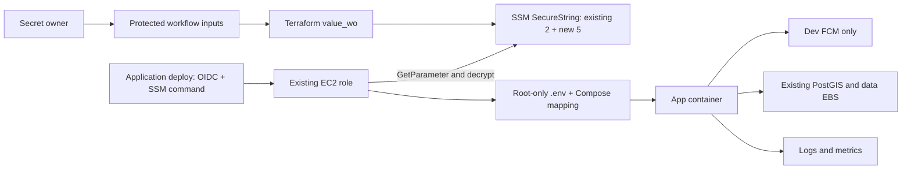

# Infrastructure Design Report: D-5

> Created at: `2026-11-20T18:04:07+09:00`
> GitHub Issue: `#364`
> Design status: `APPROVED_FOR_BUILD` — 승인자 `@Byuntil`, `2026-11-20`.
> Build gate: §9의 9개 구현 파일에 한해 구현 진행 가능. apply·배포·secret 생성은 승인 범위 밖이다.
> Decision and approval evidence: https://github.com/dnd-side-project/dnd-15th-2-backend/issues/364#issuecomment-7036145201
> GitHub 코멘트에서 H-1~H-7, H-4a와 D-5 전체 설계 승인을 확인했다.

## 1. Context and constraints

- Product stage: 기존 dev test-server의 push secret 전달 경로만 확장한다. 상위 Issue #183,
  기반 설계 D-3(#229/#233), 관련 ADR-0008을 참조한다. ECS 중심 D-2를 현재 EC2 구성으로 오인하지 않는다.
- Current evidence: 기존 root module은 DB·access token SecureString 2개를 선언한다.
  부팅 템플릿은 이 두 값을 `.env`와 Compose `environment`에 전달한다.
  배포 workflow는 기존 `.env`의 `APP_IMAGE`만 바꾼다.
- Target: Issue #364의 새 SecureString 5개를 동일한 EC2 role을 통해 컨테이너까지 전달한다.
  API·DB 계약과 worker/provider 활성화는 바꾸지 않는다.

| 입력 | 상태 | 근거 또는 후속 조치 |
| --- | --- | --- |
| 환경·Firebase 경계 | CONFIRMED | 2026-11-20 작업 지시: dev/prod 분리, 새 dev 프로젝트만 test-server에 사용 |
| dev 발송 전용 서비스 계정 | CONFIRMED | 사람 생성 완료 보고. Firebase Cloud Messaging API Admin 단일 역할. 실제 IAM 조회는 미실행 |
| 서비스 계정 JSON key | UNKNOWN | 아직 미발급. 발급 담당은 H-4에서 확정했으며 값은 에이전트에 전달하지 않음 |
| Region | CONFIRMED | D-3의 `ap-northeast-2` 유지. 현재 variables.tf도 같은 값 |
| workload·동시 사용자·외부 트래픽 | ASSUMED | D-3의 소수 개발자 테스트 규모 유지. 최신 실측 없음 |
| 저장량·증가율 | UNKNOWN | 새 구성 값 5개만 추가. 애플리케이션 데이터 증가는 이번 설계로 결정하지 않음 |
| 데이터 민감도 | CONFIRMED | credential·AES/HMAC은 비밀. 프로젝트·계정 식별자도 문서와 로그에서 제외 |
| JSON 크기 | ASSUMED | compact UTF-8 JSON이 4 KiB 이하. 미발급이라 측정하지 못함 |
| 예산 상한 | UNKNOWN | D-3의 과거 10 USD 상한과 자동 정지 비활성화(#276) 이후의 불일치는 유지. H-4에 따라 전체 서버 예산 재확인은 이번 Issue 범위 밖 후속 항목 |
| 가용성·RTO·RPO | ASSUMED | 단일 AZ best-effort와 테스트 데이터 보존 방침 유지. 수치 목표 미확정 |
| 공개 범위·TLS·DNS | CONFIRMED | 기존 HTTP 테스트 경계 유지, 신규 ingress나 도메인 없음. 기존 예외의 재승인으로 간주하지 않음 |
| 배포 빈도·운영 시간·수명 | ASSUMED | 비용 계산만 월 30회 배포, 730시간 저장, 업무 시간 대응. 실제 빈도와 종료일 미확정 |
| 운영 인력 | CONFIRMED | H-4: secret owner·장애 담당 @Byuntil, 백업 담당 @tkv00 |
| 외부 연동 | CONFIRMED | dev FCM. prod Firebase와 기본 관리자 계정 key 사용 금지 |
| 법적·보안 추가 요건 | UNKNOWN | 별도 준수 요건 제시 없음. 기존 dev 공개 HTTP 예외를 넘는 데이터 사용 금지 |
| 사람 결정 | CONFIRMED | 2026-11-20 @Byuntil이 H-1~H-7과 H-2·H-3·H-6의 파일 변경 범위를 확정 |
| 구현 승인 | CONFIRMED | 위 코멘트에서 @Byuntil이 D-5 APPROVED_FOR_BUILD 승인. apply·배포 승인 아님 |

실제 secret, 계정·프로젝트 식별자, 서비스 계정 이름·이메일, ARN, 서버 주소를 기록하지 않는다.
아래 설정명과 경로는 코드 식별자 또는 논리 placeholder이며 실제 값이 아니다.

## 2. Selected baseline

- H-1·H-2 결정: A(서비스 계정 JSON + SSM)와 I(기존 인스턴스 SSM 갱신)를 선택했다.
  B(WIF)는 코드 부적합으로 탈락한 것이 아니라 후속 별도 Issue로 분리한다.
  D-5 전체 설계 승인은 위 GitHub 코멘트에 별도로 기록되어 있다.
- Network: 기존 HTTPS egress로 SSM/KMS, Google OAuth·FCM에 접근한다. 신규 NAT, endpoint,
  ingress, 관리 포트는 만들지 않는다.
- Compute/database: 기존 EC2와 Compose app/PostGIS 유지. 데이터 볼륨·EIP·DB 변경 없음.
- Storage: 기존 경로 prefix 아래 새 SecureString 5개. `alias/aws/ssm`, Standard tier를
  기본으로 선택했다. H-4에 따라 발급 후 JSON 바이트 수만 측정하고 4 KiB 초과 시 credential
  파라미터만 Advanced 비용을 승인했다. 생성은 Terraform만 담당하며 사람이 콘솔/CLI로 SSM을 선생성하지 않는다.
- Observability: 기존 로컬 Docker 로그 한도와 기본 메트릭 유지. 값 없는 주입 성공/실패 단계만 기록한다.
  CloudTrail·로그 보존·알람의 실제 설정은 이번 세션에서 조회하지 않았다.
- Backup/recovery: 기존 데이터 EBS의 삭제 보호를 유지한다. 새 스냅샷 서비스는 추가하지 않는다.
  secret 복구는 보호된 원본과 SSM의 승인된 이전 버전으로 수행하며 키 폐기 이후에는 복구할 수 없다.
- Deployment: 보호된 infrastructure workflow로 리소스/IAM 반영 후, 사람이 승인한 애플리케이션
  배포에서 EC2가 SSM 값을 읽고 `.env`와 Compose 매핑을 함께 갱신한다.

### 주입 계약

| 논리 SSM suffix 제안 | 컨테이너 환경변수 |
| --- | --- |
| `push-token-current-key-id` | `QELLO_NOTIFICATION_PUSH_TOKEN_CURRENT_KEY_ID` |
| `push-token-current-encryption-key` | `QELLO_NOTIFICATION_PUSH_TOKEN_CURRENT_ENCRYPTION_KEY_BASE64` |
| `push-token-fingerprint-key` | `QELLO_NOTIFICATION_PUSH_TOKEN_FINGERPRINT_KEY_BASE64` |
| `push-fcm-project-id` | `QELLO_NOTIFICATION_PUSH_FCM_PROJECT_ID` |
| `push-fcm-credential-json` | `QELLO_NOTIFICATION_PUSH_FCM_CREDENTIAL_JSON` |

실제 경로 prefix는 기존 root locals에서 조합한다. 값은 모두 `sensitive` 입력,
`value_wo`와 개별 `value_wo_version`으로 전달하고 output은 이름만 반환한다.
새 입력은 `ephemeral = true`도 사용하여 plan의 root 입력 변수로 값이 남는 것을 막는다.
비밀 입력은 user_data, Terraform data source, output이나 일반 속성에 전달하지 않는다.
부팅 템플릿에는 파라미터 이름만 전달한다. 기존 두 비밀값의 수명주기 변경은 범위 밖이다.

Secret owner가 AES/HMAC을 각각 독립적인 32-byte 난수로 생성해 standard Base64로 준비한다.
current key ID는 보호 중인 ciphertext와 일치해야 하며 임의 교체하지 않는다.
새 key ID·AES·fingerprint 세트는 함께 검증한다. previous 파라미터는 이번에 추가하지 않는다.

## 3. Architecture diagram



## 4. Alternatives

| Decision | Selected | Alternative | Cost | Operations | Risk | Why |
| --- | --- | --- | --- | --- | --- | --- |
| 인증 | A: 서비스 계정 JSON을 SSM SecureString에 저장 | B: AWS provider WIF + 서비스 계정 impersonation | A Standard 저장 무료, KMS 요청 유료 가능. B는 키 저장·회전 불필요하나 egress·운영비 별도 | A는 기존 경로 재사용, B는 GCP pool/provider·binding·API 관리 추가 | A는 장기 GCP key 유출, B는 신뢰 조건 과대 허용·STS 의존 | H-1에서 A 선택. B는 후속 별도 Issue |
| 비밀 저장 | SSM | Secrets Manager | §6 | 후자는 자동 회전 연동을 별도로 구현해야 함 | 두 서비스 모두 런타임 유출 위험은 존재 | 현재 요구에 자동 회전 구현 근거 없음 |
| 기존 인스턴스 | I: 배포의 SSM 명령에서 .env와 Compose 매핑 갱신 | II: EC2 교체 | I는 새 고정 리소스 비용 없음, II는 교체/복구 작업 비용 발생 가능 | I는 app 재기동, II는 EBS 재부착·EIP 재연결·대상 ID 갱신 필요 | I HIGH(runtime IAM 변경), II CRITICAL(교체) | H-2에서 I 선택, 인스턴스 교체 없이 반영 |
| 컴퓨트·DB | 기존 EC2 + PostGIS 유지 | ECS/RDS 전환 | 재견적 대상 아님 | 별도 마이그레이션 | 이번 범위와 불일치 | 워크로드 재설계 요구가 없으므로 서비스 전체 후보 비교는 제외 |

### B: WIF 코드 적합성 및 관리 경계

`GoogleCredentialsFcmAccessTokenProvider`는 `GoogleCredentials.fromStream(...)` →
`createScoped(firebase.messaging)` → `refreshIfExpired()`를 사용하고
`ServiceAccountCredentials`로 cast하지 않는다. 따라서 JSON 입력을 외부 계정 설정으로
바꿀 수 있는 구조다. `GOOGLE_APPLICATION_CREDENTIALS`만 설정하는 방식은 현재 이 코드의
명시적 JSON 입력을 대체하지 않는다.

`build.gradle`의 고정 버전은 `google-auth-library-oauth2-http:1.50.0`이다.
로컬 고정 JAR를 `javap`으로 확인한 결과 `GoogleCredentials.fromStream`에
`EXTERNAL_ACCOUNT_CREDENTIALS` → `ExternalAccountCredentials.fromJson` 분기가 있고,
`AwsCredentials`는 `ExternalAccountCredentials`를 상속하며 `createScoped`를 제공한다.
`AwsCredentialSource`에는 `imdsv2SessionTokenUrl` 필드가 있다.
이는 정적 호환성 증거이지 실제 WIF 토큰 교환·FCM 성공 증거가 아니다.
공식 Java WIF 지원 최소 버전은 0.24.0이다[S4]. 고정 버전의 호환성 판단은
upstream 최신 코드가 아니라 위 로컬 1.50.0 JAR 확인에 근거한다.

H-1에 따라 B는 후속 별도 Issue다. 향후 전환할 경우 다음을 별도 설계·승인한다.

1. dev GCP project의 workload identity pool, AWS provider, AWS account+정확한 EC2 role
   제한 조건/attribute mapping, 해당 서비스 계정의 `roles/iam.workloadIdentityUser` binding,
   필요한 STS/IAM Credentials API. 서비스 계정의 FCM 역할은 그대로 최소 범위로 유지한다.
2. 현재 IMDSv2 required, hop limit 2를 유지하고 `--enable-imdsv2`로 생성한
   `external_account` 설정을 사용한다. 컨테이너에서 metadata 및 토큰 교환을 검증한다.
   장기 AWS key나 IMDSv1 완화를 대안으로 넣지 않는다.
3. WIF 구성 JSON에는 private key가 없지만 신뢰 설정과 실제 식별자가 있으므로 통제된 입력으로
   다룬다. 임의 URL·실행형 credential source를 허용하지 않는다.
4. GCP pool/provider/IAM은 Terraform 관리가 가능하지만 현재 저장소는 AWS provider만 사용한다.
   새 GCP root module, provider 버전/lock, State 분리, bootstrap 인증과 소유자를 승인해야 한다.
   AWS의 Terraform 전용 정책이 GCP의 임의 수동 구성을 승인하는 것은 아니다.
   수동 GCP 관리를 선택하려면 소유자·drift 탐지·복구 절차를 명시적으로 결정한다.
5. B의 별도 pool/provider/IAM 해제는 A로 JSON만 되돌리는 것과 다르다. credential 원복 후
   토큰 교환/발송 복구를 검증한 다음 불필요한 binding을 제거한다.

가용성은 A가 Google OAuth/FCM, B가 추가로 STS·impersonation 및 AWS metadata에 의존한다.
둘 다 다중 인스턴스 확장이 가능하지만 공유 EC2 role은 동일한 권한 경계를 공유한다.
향후 A→B 전환은 JSON 변경 외에 GCP IaC·신뢰 정책·live 검증 비용이 발생한다.
회전 운영 부담은 B가 낮고 현재 변경 범위의 운영 부담은 A가 낮다.

### I: 기존 인스턴스 반영 절차

H-2에서 아래 staging·검증·게시를 위한 `.github/workflows/deploy-test-server.yml` 변경 범위를
승인했다. 위 GitHub 코멘트의 D-5 전체 승인에 따라 구현한다.

`user_data_replace_on_change = false`만 유지한 채 template을 바꾸는 것으로는 기존 호스트의
`.env` 또는 `compose.yaml`이 바뀌지 않는다. user_data 전체를 재실행하는 방식도 사용하지 않는다.

1. 새 부팅 경로에는 템플릿의 `environment`에 5개 매핑을 넣는다. 기존 호스트 경로는
   배포 SSM 명령이 비밀값 없는 5개 매핑의 `compose.push.yaml` override를 생성하고,
   기본 Compose 파일과 함께 명시적으로 사용한다. 기존 DB·포트·볼륨 정의는 건드리지 않는다.
2. GitHub runner는 파라미터 이름과 승인된 스크립트만 SSM에 전달한다. 값은 EC2 role로
   호스트 내부에서 조회하며 send-command payload·CLI 인자·stdout/stderr로 전달하지 않는다.
3. `umask 077`, root 소유, 0600 임시 파일을 사용한다. 새 5개 값을 전부 조회·검증한 후
   기존 `.env`의 다른 항목을 보존하고 새 key 중복만 제거해 갱신한다.
   credential은 JSON parse 후 compact 한 줄로 직렬화한다. PEM 안의 `\\n`은 JSON escape로
   보존하며 실제 개행으로 풀지 않는다. dotenv는 literal single quote와 quote escape 규칙을
   지켜 `$`, backslash, quote를 보존한다[S5]. shell `source`나 `eval`은 사용하지 않는다.
   AWS CLI·JSON parser·Compose 검증의 stderr와 예외 원문은 메모리 안에서 받아 단계별 고정
   실패 코드로 치환하고 원문을 폐기한다. 부팅의 tee 로그와 SSM stderr에도 원문을 보내지 않는다.
   원문 진단 파일은 기본으로 저장하지 않는다. 별도 진단 보관은 접근·만료 정책의 사람 승인이 필요하다.
4. staging `.env`와 override 조합을 `docker compose ... config --quiet`로 확인한다.
   전체 config·환경변수 출력은 금지한다. 두 파일이 모두 준비된 뒤 같은 디렉터리의 rename으로
   게시한다. 각 파일의 rename은 원자적이지만 두 파일 전체는 하나의 원자적 연산이 아니므로,
   중간 실패 시 이전 조합으로 복구하며 두 파일 게시 전에는 컨테이너를 재생성하지 않는다.
5. 배포와 롤백 모두 `-f compose.yaml -f compose.push.yaml --env-file .env` 조합을 사용한다.
   app 재생성과 기존 health check 후 값이 아닌 존재/형식/파싱 성공 여부만 검증한다.
   새 호스트에서도 같은 override를 허용하므로 생성 경로와 갱신 경로가 모두 5개를 전달한다.
6. 조회·형식·구성 검증 실패는 기존 파일/컨테이너를 보존하고 실패로 종료한다.
   게시 이후의 health 실패는 workflow 실패로 보고하고 사람이 §8의 복구를 수행한다.

override와 환경 파일의 재생성·반복 실행이 멱등해야 한다. overlay를 빠뜨린 수동 재배포는
지원 절차가 아니므로 README의 배포/롤백 명령도 같은 조합으로 고정한다.

staging·실행·롤백 모두 Compose의 shell 환경 우선순위를 제거한다. 기존 `export APP_IMAGE`에
의존하지 않으며, 아래와 같이 새 환경에서 실행해 값은 지정된 env 파일에서만 읽는다.
`STAGED_ENV`와 `STAGED_OVERRIDE`는 동일 작업의 root-only 임시 파일 경로이지 비밀값이 아니다.

```bash
env -i PATH="$PATH" HOME=/root docker compose \
  --project-directory /opt/qello --env-file "$STAGED_ENV" \
  -f /opt/qello/compose.yaml -f "$STAGED_OVERRIDE" config --quiet
env -i PATH="$PATH" HOME=/root docker compose \
  --project-directory /opt/qello --env-file /opt/qello/.env \
  -f /opt/qello/compose.yaml -f /opt/qello/compose.push.yaml pull app
env -i PATH="$PATH" HOME=/root docker compose \
  --project-directory /opt/qello --env-file /opt/qello/.env \
  -f /opt/qello/compose.yaml -f /opt/qello/compose.push.yaml up -d --no-deps app
```

staging 검사는 구성 유효성만 증명한다. 이미지 SHA 선택과 JSON byte 보존은 별도 비교로
검증한다. 필요한 effective config를 검사 프로세스의 메모리로만 받아 비교하고,
값·전체 config를 파일이나 로그로 출력하지 않는다.
정상 배포 전에 root-only 직전 env/override의 일치하는 세트와 override의 기존 부재 여부를
기록한다. 백업은 디렉터리 0700·파일 0600이며 H-4a에 따라 직전 성공 세트 1개만
보관하고 다음 성공 배포 때 교체한다. 별도 기간 보존은 두지 않는다. 백업 담당은 @tkv00이다.
롤백은 SSM 재조회·새 이미지 갱신 경로를 호출하지 않고 이 세트를 먼저
복구한 뒤 위와 같은 비상속 환경/명시적 파일 명령으로 이전 app만 재생성한다.
기존에 override가 없었다면 그 상태를 복원하고 기본 Compose 파일만 명시적으로 사용한다.
합의된 이전 이미지 SHA와 effective image를 출력 없이 비교한 뒤 health를 확인한다.

## 5. Security and IAM

- Runtime role: 기존 2개 + 새 5개의 정확한 ARN 목록으로 `ssm:GetParameter`,
  `ssm:GetParameters`를 제한한다. `kms:Decrypt`는 기존 SSM key,
  `kms:ViaService`와 `kms:EncryptionContext:PARAMETER_ARN`의 같은 7개 목록 조건을 유지한다.
  IAM user, role trust 확대, prefix wildcard read, `GetParametersByPath` 추가는 하지 않는다.
- Confirmed blocker SEC-01: 연결된 `AmazonSSMManagedInstanceCore`의 공개 정책은
  `ssm:GetParameter`와 `ssm:GetParameters`를 `Resource: *`로 허용한다[S11].
  기본 SSM KMS key의 계정 내 복호화 허용 경로도 좁은 inline Allow만으로 제한되지 않는다[S15].
  따라서 7개 ARN Allow만 추가하는 것으로 범위 밖 접근 거부를 달성하지 못한다.
  실제 SCP·boundary·다른 정책은 조회하지 않았으며 제한이 이미 있다고 가정하지 않는다.
- H-6 확정(선택지 1): `AmazonSSMManagedInstanceCore`를 유지하고 해당 두 조회 action의 7개 밖
  리소스에는 명시적 Deny를 두고, SSM key 복호화는 허용 7개 encryption context 밖을 거부하는
  통제를 적용한다. S3 key 복호화에는 영향을 주지 않도록 SSM 기본 key에 한정한다.
  `infra/modules/app-server/main.tf` 정책 변경 범위는 승인되었으며 관리형 정책 제거·광역
  접근 예외는 선택하지 않았다. D-5 전체 승인 후 구현 단계에서 SSM Agent의 Run Command
  배포 경로와 허용 7개 밖 접근 거부를 검증한다. 결정만으로 실제 권한 문제가 해소된 것은 아니다.
- Deployment role/GitHub OIDC: 기존 이미지 push와 특정 EC2 SSM 명령 권한을 유지한다.
  runner에 새 SSM 값 read를 주지 않는다. 보호된 apply 역할과 application deploy 역할은 별개다.
- State/plan: `value_wo`만으로 일반 root 입력 변수가 plan에서 제외되는 것은 아니다.
  새 값의 `sensitive + ephemeral`을 함께 검증한다[S6,S7]. `.tfvars`, user_data, 산출물,
  plan JSON, Actions output에 값을 쓰지 않는다. plan 파일은 민감정보로 취급한다.
- Input binding decision: 현재 `infrastructure-apply.yml`은 기존 두 secret만 `TF_VAR_*`에 연결한다.
  새 5개 변수는 secret 등록만으로 자동 주입되지 않는다. H-3에서 해당 파일의 새 5개 secret
  TF_VAR 입력 binding 추가만 승인했다. Environment·확인 문구·승인 게이트·트리거는 바꾸지 않는다.
  실제 workflow 변경은 D-5 전체 승인 후에만 수행한다.
  사람이 secret 입력을 제공하는 것과 수동 SSM 리소스 생성은 다른 작업이다.
- Network/encryption: HTTPS egress 유지, SSM SecureString과 암호화 EBS 사용.
  기존 공개 HTTP의 token 노출 잔여 위험은 유지되며 dev 전용 계정·데이터만 사용한다.
- Local exposure: `.env`는 root/Docker 접근자에게 평문이고 컨테이너 환경은 Docker 관리자에게
  보인다. SSM 암호화로 런타임 관리자 노출까지 없어지는 것은 아니다.
- Audit/logs: key/credential과 토큰 원문, project/account ID, ARN을 출력하지 않는다.
  shell tracing, `docker inspect`, 전체 Compose config 및 Google auth debug 로그를 사용하지 않는다.
  SSM/CloudTrail의 기존 감사 가능성은 유지하되 실제 retention과 모든 로그 경로는 후속 검증 대상이다.
- SEC-02 반영 계약: 배포 workflow의 기존 `StandardErrorContent` 원문 복사를 새 주입 경로에서도
  재사용하지 않는다. 실패 시 고정 단계명·코드·status만 반환하도록 H-2 범위에서 바꾼다.
  root SSM 명령을 보낼 수 있는 deploy 역할은 직접 SSM read가 없어도 간접적인 secret 접근
  권한이 있으므로 보호·리뷰 경계에 포함한다.

## 6. One-month cost estimate

USD, `ap-northeast-2`, 2026-11-20 조회. 기존 서버 전체 재견적이 아니라 **이번 변경의 증분**이다.
월 730시간 저장, 배포 30회, 각 배포에 새 5개 값 1회 조회(150 interactions)를 ASSUMED로 둔다.
현재 실행 개수 1, 새 compute/DB/EBS/EIP/NAT/DNS/LB/백업/중앙 로그 리소스 0이다.
기존 IOPS·트래픽·로그 수집량의 실측은 UNKNOWN이며 이 설계가 기존 총비용을 승인하지 않는다.

| 항목 | 가정·계산식 | 월 증분 추정 | 근거 |
| --- | --- | --- | --- |
| A Standard 저장·API | 5개, standard throughput | 0 USD | [S1] |
| AWS 관리형 SSM key 저장 | 새 CMK 없음 | 0 USD | [S2] |
| KMS 요청(최초 월) | 최초 write 5 + 배포 decrypt 150 = 155, free tier 미적용 시 `155 × 0.03 / 10000` | 0.000465 USD + 추가 요청 비용 | [S2,S3] |
| KMS 요청(반복 월) | 추가 write가 없으면 배포 decrypt 150, `150 × 0.03 / 10000` | 0.000450 USD + 추가 요청 비용 | [S2,S3] |
| EC2·DB·EBS·네트워크 장비·관측성·백업 | 기존 리소스 유지 | 고정비 증분 0 USD | §2의 리소스 범위. 실제 egress는 별도 |
| FCM 인증 egress·추가 운영 작업 | 요청량·전송량·운영 시간 미측정 | UNKNOWN, 위 합계에 포함하지 않음 | 별도 usage 확인 필요 |
| A Advanced 대안 | credential만 4 KiB 초과~8 KiB 이하: `730 × 0.000070 + 30 × 0.05 / 10000` | 0.05125 USD + KMS·추가 API·egress | [S8,S12] |
| Secrets Manager 대안 | 비교용 5개 별도 secret: `5 × 0.40 + 150 × 0.05 / 10000` | 2.00075 USD + 추가 API·해당 KMS·egress·회전 실행비 | [S9] |
| B WIF | IAM/WIF 직접 서비스 요금 0. 토큰 교환 경로의 egress와 구축·운영비는 별도 | 총 증분 UNKNOWN | [S10,S13] |

KMS 대칭 요청 서울 단가는 공식 regional price list의 `awskms-APIRequest-All`에서
0.000003 USD/request로 확인했다(공표일 2026-11-08). 기존 계정의 무료 요청 잔여량은
UNKNOWN이므로 보수적으로 전액 계산했다. 실제 추가 request 수를 R이라 하면
KMS 추정은 최초 월 `(155 + R) × 0.000003`, 추가 write 없는 반복 월은
`(150 + R) × 0.000003`이다. provider refresh·재시도·실패와 plan 검증의 KMS 호출은 R에 포함한다.
Advanced의 30회 및 Secrets Manager의 150회는 배포 조회만 산정한 소계다.
생성·변경·추가 조회 등 유료 API interaction 수를 각각 P, M이라 하면 별도로
`P × 0.000005`, `M × 0.000005 USD`를 더한다. 이 비용은 KMS 변수 R에 포함되지 않는다.
SSM 과금 단위는 HTTP 호출 수가 아니라 개별 파라미터 interaction 수다.
최초 write와 배포 재실행·부팅·롤백·회전 횟수도 실제 사용량에서 분리해 계수한다.

- A Standard는 현재 5개 비밀 저장 계약을 유지하는 유료 저장 대안보다 직접비용이 낮고
  기존 운영 경로를 재사용한다. WIF의 직접 identity 서비스 요금도 0이므로 A의 전체
  최저비용은 입증하지 않았다. 장기 key 회전 부담은 B가 더 낮다.
  자동 회전이 필요해지면 Secrets Manager와 B를 재평가한다.
- Advanced 공식 요약가격은 월 0.05 USD지만 서울 지역 기계 판독 가격은 시간당
  0.000070 USD다(공표일 2026-11-18). 이 보고서의 730시간 가정에는 0.0511 USD를 적용했다.
  H-4에서 JSON이 4 KiB 초과인 경우 credential 파라미터만 Advanced의 월 약 0.05 USD 비용을
  승인했다. 실제 발급 후 비밀 원문이 아닌 바이트 수만 증거로 남긴다.
- API traffic 2배가 배포/부팅 횟수 변화 없이 발생하면 SSM/KMS 조회는 그대로다.
  배포도 2배라면 `5 + 60 × 5 = 305` KMS 요청, `0.000915 USD + R 비용`이다.
- 값 저장 크기 3배라도 각각 4 KiB 이하면 저장료는 같다. credential이 4 KiB를 넘으면
  H-4의 조건부 비용 승인에 따라 credential만 Advanced로 전환한다.
  다른 파라미터의 tier 변경은 승인 범위가 아니다. 8 KiB도 넘으면 저장 방식 재설계 전까지 BLOCKED이다.
- 로그량 3배는 기존 로컬 로그 회전의 유실 위험을 늘린다. 새 중앙 수집을 만들지 않아
  고정 증분은 없지만 신규 수집/보존 확대의 비용은 별도 승인한다.
- 기본 SSM read throughput은 관련 세 조회 API가 공유하는 40 TPS다. 월 150회 가정으로
  순간 부하 여유를 증명하지 않는다. 높은 throughput을 켜면 Standard도 interaction 요금이
  발생하므로 현재의 무료 API 가정을 재검토한다.
- Advanced→Standard는 제자리 downgrade가 아니다. 파라미터 재생성과 비밀 주입 중단 위험을
  재검토해야 하며 비용 절감을 위해 자동 삭제하지 않는다.

위 계산은 세금·환율·할인·계정의 공유 무료 한도와 실측 사용량을 제외한 추정치이며 실제 청구액이 아니다.

## 7. Operational concerns

- Secret owner·장애 담당: H-4에 따라 @Byuntil. dev credential 발급, 두 독립 key와 key ID 준비,
  보호된 입력 등록, 크기 측정과 회전/폐기를 담당한다. 발급 후 JSON의 바이트 수만 증거로 남긴다.
- Backup owner: @tkv00. 복구본 접근과 이전 env/override 세트 보존을 담당한다.
- Rotation review: `2027-05-20`. 실제 key 회전을 이날 자동 수행한다는 결정은 아니다.
- 전체 서버 예산 재확인은 이번 Issue 범위 밖 후속 항목이다. 현재 전체 예산 준수를 확인한 것은 아니다.
- Capacity: 신규 서비스나 리소스 scale 변경 없음. SSM throttling 시 실패로 종료하여 기존
  실행 상태를 보존한다. 이번 설계에서 임의 retry나 높은 throughput을 켜지 않는다.
- Monitoring: 단계별 주입 성공, app health, 필요한 설정의 존재/형식 결과만 확인한다.
  health 성공만으로 다섯 환경변수 또는 실제 FCM 발송 성공을 증명하지 않는다.
- Rotation: AES/HMAC을 배포 때마다 새로 만들지 않는다. AES 교체에는 previous read와
  기존 ciphertext 복구 계획이 필요하므로 별도 이슈다. fingerprint key 교체도 기존 기기
  매칭을 깨뜨릴 수 있어 단순 SSM version 증가만으로 시행하지 않는다.
- Patch/TLS/domain: 기존 방식 유지. HTTP 예외 만료와 TLS 전환은 별도 기존 작업 범위다.

## 8. Risks and mitigations

| Risk | Trigger | Impact | Mitigation | Recovery |
| --- | --- | --- | --- | --- |
| secret 미주입 | SSM apply만 완료하고 기존 호스트 파일 미갱신 | #365 기동 실패 | .env와 Compose 매핑 동시 준비, 존재/형식 검증 | #365 병합을 보류하고 승인된 배포로 주입 |
| JSON 손상·dotenv 보간 | 실제 개행 또는 dollar/backslash 처리 오류 | 인증 실패·오염된 설정 | compact JSON과 literal dotenv 규칙, 가짜 fixture로 round-trip 검증 | 기존 env/overlay·이미지 조합 복구 |
| 일부 값만 갱신 | 조회 실패·파일 게시 도중 실패 | 혼합 key 세트, 기동 실패 | 모든 값 staging 후 구성 검사, 게시 이전에 app 재생성 금지 | 보관한 이전 파일 조합 복구, 원문 미출력 |
| AES/HMAC 유실 | 새 키 재생성 또는 이전 값 폐기 | 기존 token 복호화/매칭 실패 | key identity와 보호된 복구본 유지, 자동 회전 금지 | 읽을 수 있는 key 세트와 호환 이미지로 복구 |
| GCP key 유출 | 로그·환경·관리자 접근 | dev FCM 발송 권한 남용 | 최소 권한·dev 전용·root-only·로그 통제 | 노출 경로 차단 후 사람의 key 폐기/재발급, 보호 workflow로 교체 |
| 예상 밖 IAM 권한 | 관리형 attachment·기본 key policy | 7개 밖 비밀 접근 | effective IAM 검증, 다른 허용 경로 분리 | 별도 승인된 최소 권한 수정, 임의 정책 삭제 금지 |
| #365 조기 병합 | main 자동 배포 | test-server 기동 실패 | #364 apply와 런타임 주입 증거를 merge gate로 운영 | 호환 이전 이미지로 수동 롤백 |
| EC2 교체 | user_data 정책 변경·replace 강제 | DB 중단·볼륨 재부착·배포 대상 갱신 | I 선택, plan에 교체/삭제가 나오면 중단 | II 별도 승인과 복구 절차 없이는 실행하지 않음 |
| 부팅 정의 전환과 drift 무시 | user_data→user_data_base64(gzip) 전환 | 기존 EC2 stop/start 또는 부팅 정의의 미반영 | 추가 승인에 따라 기존 ami와 함께 user_data·user_data_base64를 ignore_changes에 지정. user data는 최초 부팅 전용이며 기존 호스트는 H-2 deploy workflow가 갱신 | 인스턴스 교체를 다루는 별도 Issue에서 예외 제거 재검토. 사람의 plan으로 실제 변경 효과 확인 |

위 lifecycle 예외와 fixture 테스트 계획의 추가 승인 증거:
https://github.com/dnd-side-project/dnd-15th-2-backend/issues/364#issuecomment-7037762767
(@Byuntil, 2026-11-20). 기존 AMI 무시와 apply 게이트는 변경하지 않는다.

Risk level: 선택안은 `HIGH`(runtime IAM 정책 변경과 SSM Agent 영향), 미선택 교체 대안은 `CRITICAL`이다.
선택안에서 예상 데이터 손실은 없지만 app 재생성 동안 짧은 중단이 있다. 실제 중단 시간은 UNKNOWN.
live plan을 실행하지 않았으므로 교체·삭제 0은 목표일 뿐 실제 결과가 아니다.

롤백은 승인된 이전 image SHA, root-only 이전 `.env`와 override 조합으로 같은 Compose 명령을
실행하고 health 및 기기 등록을 확인한다. DB 파일과 기존 두 secret은 변경하지 않는다.
credential 회전은 승인된 이전 SSM 값으로 `value_wo_version`을 증가시켜 보호 workflow에서
복구한 후 호스트에 재주입한다. 폐기된 GCP key로는 롤백하지 않는다.
#365 이후에는 token-protection 설정을 통째로 제거하는 롤백이 유효하지 않다.

## 9. IaC plan

- IaC choice: Terraform only. AWS CLI는 런타임의 값 조회·배포 전달에만 사용하며 리소스 생성을 대체하지 않는다.
- Version contract: 현재 root는 Terraform `>= 1.11.0, < 2.0.0`, AWS provider `= 6.57.1`.
  이번 설계에서 버전 또는 lockfile을 갱신하지 않는다. 실행한 Terraform 버전은 아직 없음.
- State: 기존 test-server S3 backend key, encrypt와 `use_lockfile = true` 유지.
  bootstrap의 암호화·Versioning·TLS/public 차단 정책 유지, 실제 State/serial은 조회하지 않았다.
- Plan: 승인된 환경에서만 `terraform plan -lock-timeout=5m -out=tfplan`.
  SEC-04의 현재 plan 역할 문제는 유지된다. 해당 역할은 metadata read만 허용하는데,
  고정 provider 6.57.1은 resource read에서 `GetParameter(WithDecryption=true)`를 호출한다[S16].
  H-7(선택지 1)에 따라 plan 역할 권한은 늘리지 않고 사람이 기존 MFA 인프라 역할로
  plan을 직접 실행해 plan SHA-256과 리소스 수 증거를 만든다.
  `infra/bootstrap` 변경은 범위 밖이다. 역할 분리나 보호 workflow 게이트를 완화하거나
  `-refresh=false`로 우회하지 않는다. AI가 사람용 변경 권한을 assume하지 않는다.
  현재 plan 역할의 기존 SecureString refresh 실패 가능성은 별도 후속 Issue 후보로 남긴다.
- Evidence: design_id, issue, commit SHA, Terraform version, lock SHA-256, plan 파일 SHA-256,
  기존 apply workflow의 normalized resource_changes SHA-256, State serial(가능할 때),
  생성/변경/교체/삭제 수를 구분해 보관한다. 두 hash는 다른 산출물이며 서로 대체하지 않는다.
  raw plan/JSON/State와 실제 식별자는 문서·공개 로그에 싣지 않는다.
- Drift: 승인된 계획 시점과 apply 시점 State 변경·입력 version을 확인한다.
  write-only 값은 자동 diff로 검출할 수 없으므로 version과 secret owner의 변경 기록이 필요하다.
- Tags: 기존 Project/Environment/ManagedBy 태그를 새 파라미터에도 적용한다.
  환경 경로·이름 변경과 리소스 삭제는 이번 범위가 아니다.

### 승인 이후의 파일 소유 범위

| 파일 | 변경 목적 | 게이트 |
| --- | --- | --- |
| `infra/environments/dev/test-server/main.tf` | SecureString 5개, 기존 2개+신규 5개 ARN 목록, 모듈 이름 전달 | D-5 승인 |
| `infra/environments/dev/test-server/variables.tf` | 새 sensitive/ephemeral 입력·version·tier 계약 | D-5 승인 |
| `infra/environments/dev/test-server/outputs.tf` | 값 없는 파라미터 이름 output | D-5 승인 |
| `infra/environments/dev/test-server/README.md` | 입력·반영·검증·복구 절차 | D-5 승인 |
| `infra/modules/app-server/variables.tf` | 5개 파라미터 이름 입력 | D-5 승인 |
| `infra/modules/app-server/main.tf` | user_data 이름 전달, H-6의 명시적 Deny와 관리형 정책 유지 | H-6 및 D-5 승인 완료 |
| `infra/modules/app-server/user_data.sh.tftpl` | 부팅 시 5개 조회·안전한 dotenv·Compose 매핑 | D-5 승인 |
| `.github/workflows/deploy-test-server.yml` | 기존 호스트 env와 override staging·검증·게시 | H-2 및 D-5 승인 완료 |
| `.github/workflows/infrastructure-apply.yml` | 기존 Environment·확인 문구·승인 게이트·트리거를 유지한 5개 secret TF_VAR 입력 binding만 | H-3 및 D-5 승인 완료 |

구현 수정 범위는 위 9개 파일이다. bootstrap 변경, GCP IaC, 새 공통 helper,
보안 예외·approval script 수정, 애플리케이션/테스트 변경은 위 소유 범위에 포함하지 않는다.
H-7은 기존 역할을 사람이 사용하는 방식으로 결정되었으므로 bootstrap IAM 확대를 수행하지 않는다.

## 10. Apply gate

보고서 template의 과거 "두 승인" 문구 대신 root AGENTS.md §4.8의 현재 계약을 적용한다.
이는 정책을 수정하거나 승인을 부여한 것이 아니다.

- [x] 2026-11-20 @Byuntil의 H-1~H-7 결정 및 H-2·H-3·H-6 파일 변경 범위 승인 증거 반영
- [x] @Byuntil이 D-5 전체를 `APPROVED_FOR_BUILD`로 승인 (2026-11-20, 위 코멘트)
- [ ] 승인된 파일 범위만 실행 에이전트가 구현하고 독립 검증 완료
- [ ] 실제 인프라 PR 병합, Ruleset의 승인 수 충족 및 작성자 아닌 `@Byuntil` 또는 `@tkv00` 최소 1인 승인
- [ ] apply commit이 그 PR의 merge commit과 일치, 검토한 plan hash와 State 일치
- [ ] `infrastructure-apply` Environment 승인, 사람의 정확한 dispatch 확인, OIDC 단기 권한
- [ ] #364 보호 workflow apply 완료 후 기존 인스턴스의 새 5개 주입 증거 확보
- [ ] 그 후에만 #365를 main에 병합; provider/worker 활성화 #366은 별도

AI 세션은 이 체크리스트의 상태를 추측하지 않으며 terraform apply와 실제 배포를 실행하지 않는다.

### 검증 계획과 이번 세션의 증거

이번 설계: branch/Issue/TASK 일치, 보고서 필수 절, 실제 코드·고정 JAR 정적 확인,
공식 가격 근거, 독립 보안/비용 검토, secret preflight, harness와 공백 검사.
문서 내용 자체를 pin하는 테스트는 추가하지 않는다.

구현 승인 이후:

1. Terraform fmt/init(-backend=false)/validate와 저장소에 구성된 tflint, terraform test,
   Checkov, Conftest, Infracost, terraform-docs의 적용 범위를 확인해 실행한다.
2. 승인된 테스트 계획으로 가짜 JSON의 newline/dollar/quote/backslash round-trip,
   32-byte AES/HMAC 검증, 4/8 KiB 경계, 누락/권한 거부 시 기존 파일 보존,
   반복 실행 중복 제거와 staging 실패 복구를 검증한다. 가짜 AccessDenied의 식별자·credential
   원문 비노출과 shell `APP_IMAGE`가 있어도 env 파일의 이미지로 복구되는지도 검증한다.
   실제 secret은 fixture로 쓰지 않는다.
3. plan은 새 파라미터 5개와 제한된 in-place 갱신만 허용한다. replace/delete 또는
   예상 외 리소스·권한 변경이 있으면 중단하고 재승인한다.
4. 실제 관리형 role attachment와 KMS 정책까지 확인해 허용 7개 read/decrypt 및
   범위 밖 접근 거부를 검증한다. H-6에 따라 관리형 정책을 유지한 상태에서
   SSM Agent의 Run Command 배포 경로와 기존 S3 key 복호화도 검증한다.
   로그에는 값과 실제 식별자를 남기지 않는다.
5. 새 인스턴스 렌더링 경로와 기존 인스턴스 반영 경로 모두 다섯 변수가 컨테이너에 도달하는지
   boolean/형식 결과로 검증한다. 기존 DB·access token 환경변수와 볼륨 보존도 확인한다.
6. 승인된 테스트와 `./harness pr-ready --project-tests`를 실행한다.
   이번에는 JUnit 계획의 사람 승인 전이므로 실행하지 않는다.
7. live credential parse/OAuth 발급/발송은 승인된 dev 환경에서 수행한다.
   #364는 provider/worker 활성화를 하지 않는다. live 발송 성공과 단순 주입 성공을 구분한다.

세션 검증 결과와 독립 검토 결과는 아래에 실제 실행 후 기록한다.

## 11. Decision

결정·승인자: 사용자 `@Byuntil`. 결정·승인일: `2026-11-20`.
증거: https://github.com/dnd-side-project/dnd-15th-2-backend/issues/364#issuecomment-7036145201
코멘트에 기록된 H-1~H-7, H-4a 및 `APPROVED_FOR_BUILD`를 적용한다. apply·배포는 포함하지 않는다.

| ID | 확정한 사람의 결정 | 승인 범위와 남은 실행 경계 |
| --- | --- | --- |
| H-1 | A 선택: 서비스 계정 JSON을 SSM SecureString Standard에 저장 | B(WIF)는 후속 별도 Issue |
| H-2 | I 선택: 인스턴스 교체 없이 SSM 명령에서 .env와 compose.push.yaml staging·검증·게시 | .github/workflows/deploy-test-server.yml의 이 변경 범위 승인 |
| H-3 | 새 5개 secret TF_VAR 입력 binding 추가만 승인 | .github/workflows/infrastructure-apply.yml의 Environment·확인 문구·승인 게이트·트리거 변경 금지 |
| H-4 | secret owner·장애 담당 @Byuntil, 백업 담당 @tkv00; 회전 재검토일 2027-05-20 | key 발급 후 JSON 바이트 수만 증거로 기록; 4 KiB 초과 시 credential만 Advanced 비용(월 약 0.05 USD) 승인; 전체 서버 예산 재확인은 이번 Issue 밖 후속 항목 |
| H-4a | 롤백용 이전 .env·override는 직전 성공 세트 1개만 보관하고 다음 성공 배포 때 교체 | 별도 기간 보존 없음 |
| H-5 | #364 보호 workflow apply와 기존 인스턴스 5개 주입 검증 후에만 #365 main 병합 | 순서 결정이지 apply·배포 실행이나 D-5 전체 승인 아님 |
| H-6 | 선택지 1: runtime role의 허용 7개 밖 GetParameter/GetParameters와 SSM 기본 key의 7개 밖 encryption context 복호화를 명시적 Deny | S3 key 복호화 영향 없음, AmazonSSMManagedInstanceCore 유지; infra/modules/app-server/main.tf 정책 변경 범위 승인; 구현 단계에서 SSM Agent Run Command 배포 경로와 범위 밖 거부 검증 |
| H-7 | 선택지 1: plan 역할 권한을 늘리지 않고 사람이 기존 MFA 인프라 역할로 plan 직접 실행 | plan SHA-256·리소스 수 증거 필요; -refresh=false 우회 금지; infra/bootstrap 변경 범위 밖; 현재 plan 역할의 기존 SecureString refresh 실패 가능성은 별도 후속 Issue 후보 |

후속 항목은 문서에만 남겼으며 이번 요청에서 GitHub Issue를 생성하지 않았다.
H-1~H-7 결정과 별도로 위 코멘트에서 D-5 전체 설계를 승인했다.
설계 상태는 `APPROVED_FOR_BUILD`이며 구현 진행 가능하다. 이는 Issue #364 구현 완료나 apply 승인이 아니다.
미발급 credential 크기와 live 검증은 사실로 채우지 않고 승인/실행 게이트로 남긴다.

### 공식 자료

모두 2026-11-20 조회. 코드 근거는 본문에 명시한 저장소 파일과 고정 1.50.0 JAR다.

- [S1] AWS Systems Manager pricing: https://aws.amazon.com/systems-manager/pricing/
- [S2] AWS KMS pricing: https://aws.amazon.com/kms/pricing/
- [S3] AWS KMS Seoul price list: https://pricing.us-east-1.amazonaws.com/offers/v1.0/aws/awskms/current/ap-northeast-2/index.json
- [S4] Google WIF with AWS: https://docs.cloud.google.com/iam/docs/workload-identity-federation-with-other-clouds
- [S5] Compose interpolation and env syntax: https://docs.docker.com/compose/how-tos/environment-variables/variable-interpolation/
- [S6] Terraform ephemeral values: https://developer.hashicorp.com/terraform/language/manage-sensitive-data/ephemeral
- [S7] AWS provider 6.57.1 SSM write-only argument: https://raw.githubusercontent.com/hashicorp/terraform-provider-aws/v6.57.1/website/docs/r/ssm_parameter.html.markdown
- [S8] Parameter tiers: https://docs.aws.amazon.com/systems-manager/latest/userguide/parameter-store-advanced-parameters.html
- [S9] Secrets Manager pricing: https://aws.amazon.com/secrets-manager/pricing/
- [S10] Google IAM pricing: https://cloud.google.com/iam/pricing
- [S11] AmazonSSMManagedInstanceCore policy: https://docs.aws.amazon.com/aws-managed-policy/latest/reference/AmazonSSMManagedInstanceCore.html
- [S12] AWS Systems Manager Seoul price list: https://pricing.us-east-1.amazonaws.com/offers/v1.0/aws/AWSSystemsManager/current/ap-northeast-2/index.json
- [S13] Google IAM/WIF product and pricing: https://cloud.google.com/products/iam
- [S14] Terraform ephemeral input variables: https://developer.hashicorp.com/terraform/language/values/variables
- [S15] Parameter Store KMS access: https://docs.aws.amazon.com/systems-manager/latest/userguide/secure-string-parameter-kms-encryption.html
- [S16] AWS provider 6.57.1 SSM read implementation: https://raw.githubusercontent.com/hashicorp/terraform-provider-aws/v6.57.1/internal/service/ssm/parameter.go

### 독립 검토 및 초기 설계 작성 시 검증 기록

아래 독립 검토 판정과 명령 결과는 결정 반영 전 초기 설계 작성 시의 기록이다.
2026-11-20 사람 결정으로 선택한 대응은 §11에 별도로 반영하며 원래 판정을 덮어쓰지 않는다.

- 독립 비용 검토 `d5-cost`: 동결 초안 판정 FAIL. Advanced 시간 과금(P2),
  A 최저비용 단정(P2), 최초/반복 월·추가 API 분리(P3)를 발견했다.
  위 §6에 0.05125 USD로 교정하고, WIF 직접 요금과 전체 미확정 비용, R/P/M 및
  최초/반복 월을 구분했다. 설계자가 반영했으며 독립 재검토를 통과했다고 주장하지 않는다.
- 독립 보안 검토 `d5-security`: BLOCKED. SEC-01 HIGH(실효 SSM/KMS 제한 게이트 누락),
  SEC-02 MEDIUM(오류 로그), SEC-03 MEDIUM(Compose 입력·롤백 우선순위),
  SEC-04 MEDIUM(plan refresh 권한)을 발견했다.
  SEC-02·03의 요구를 §4·5의 실행 계약과 후속 검증 계획에 반영했다.
  초기 초안에서 SEC-01·04를 H-6·H-7의 명시적 차단으로 승격했다.
  이후 사람 결정은 SEC-01에 명시적 Deny, SEC-04에 사람의 기존 MFA 역할 plan 경로를 선택했다.
  이 결정으로 대응 방식은 확정되었지만 실제 구현·검증·D-5 전체 승인 완료로 처리하지 않는다.
  고정 JAR 분석은 설계자가 수행했으며 보안 검토자가 재현했다고 주장하지 않는다.
- 두 검토는 동일 동결 초안에 대해 독립적으로 수행되었으며 원래 비용 FAIL과 보안 BLOCKED를
  보존한다. 통합 수정은 설계자의 작업이고 독립 재검토 통과 또는 설계 승인과 다르다.
- `harness start`, `task-init`, `infra-design --id D-5`가 각각 exit 0으로 완료되었다.
  Issue #364는 OPEN이고 GitHub Project 연결이 확인되었다. 현재 branch·TASK·Issue가 일치한다.
- `./harness check`, `./harness pr-ready`(project-tests 제외), `npm run hooks:validate`가
  각각 exit 0이었다. 최종 pr-ready 실행에는 secret preflight, JUnit 정책 정적 검사,
  관례·커밋 형식·workflow·label·Husky·Java baseline 검사와 `git diff --check`가 포함되었다.
  JUnit 정책 정적 검사는 JUnit 테스트 실행과 다르다.
- `git diff --exit-code -- .gitignore`와 origin/main ancestor 확인은 exit 0이었다.
  작업 트리 변경은 TASK와 이 보고서뿐이다. `.git/info/exclude`는 수정하지 않았다.
- `src/test/AGENTS.md`와 `src/integrationTest/AGENTS.md`의
  "테스트 작성·실행 전에는 계획의 사람 승인을 확인하고"는 명시적 요구이므로
  JUnit 계획 승인 없는 이번 설계 요청에서 `pr-ready --project-tests`를 실행하지 않았다.
- Terraform 파일을 변경하지 않았고 구현·plan 환경 승인이 없으므로 fmt/init/validate 및
  Terraform 부가 검사·실제 plan·runtime smoke를 실행하지 않았다.
  후속 구현의 필수 검증에서 생략할 수 있다는 뜻이 아니다.

최종 결과 계약:

```yaml
status: BLOCKED
issue_number: 364
task_id: GH-364-DESIGN
design_id: D-5
changed_files:
  - TASK.md
  - docs/reports/infrastructure/gh-364-D-5.md
executed_checks:
  - harness check
  - harness pr-ready (without project-tests)
  - npm run hooks:validate
  - git diff --check
  - git diff --exit-code -- .gitignore
  - git merge-base --is-ancestor origin/main HEAD
passed_checks: all executed command checks exited 0
failed_checks: []
blocked_checks:
  - JUnit and pr-ready --project-tests (test-plan approval pending)
  - Terraform static/build checks (implementation approval pending)
  - live plan (human MFA executor selected; plan evidence not generated)
  - effective IAM and runtime/FCM validation (H-6 control selected; implementation and live validation pending)
assumptions: section 1 intake and section 6 estimates; not live observations
risks: HIGH runtime IAM change; SEC-01 implementation and SEC-04 human plan evidence remain unverified
required_human_decisions: D-5 approval recorded; human plan and later PR/Environment approvals remain
terraform_version: NOT_RUN
provider_lock_sha256: NOT_MEASURED_UNCHANGED
plan_sha256: NOT_GENERATED
created_resources: NOT_PLANNED
updated_resources: NOT_PLANNED
replaced_resources: NOT_PLANNED
deleted_resources: NOT_PLANNED
cost_delta: section 6 direct-cost subtotal only; total UNKNOWN
security_findings: SEC-01 HIGH; SEC-02/03/04 MEDIUM; disposition above
```

위 status의 BLOCKED는 구현·검증과 D-5 전체 승인 게이트를 뜻한다.
이전 설계 단계의 BLOCKED 기록과 별개로 현재 Design status는 위 승인에 따라 `APPROVED_FOR_BUILD`다.
구현과 정적 검증을 진행하며 사람의 plan·live 검증 및 PR/Environment 승인을 대신하지 않는다.
