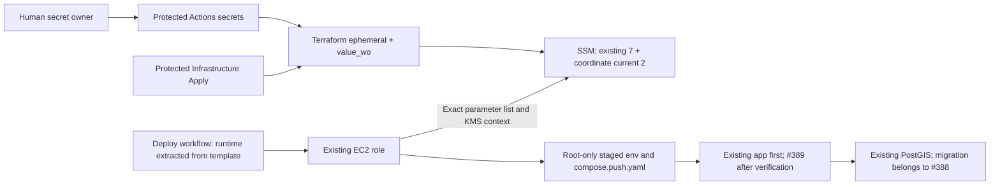

# Infrastructure Design Report: D-6

> Created at: `2026-11-25T04:16:40Z`
> GitHub Issue: `#390`
> Task: `GH-390-DESIGN`
> Design status: `APPROVED_FOR_BUILD` — 승인자 `@Byuntil`, 승인일 `2026-11-25`.
> Approval evidence: `https://github.com/dnd-side-project/dnd-15th-2-backend/issues/390#issuecomment-7153016641`
> Build gate: §9의 10개 파일 범위 승인. 테스트 파일 2개는 별도 D-6 테스트 계획 승인 후 변경한다.
> Scope: 설계만 작성. AWS 접근, Terraform plan/apply, 배포, secret 생성, 커밋·push 미실행.

## 1. Context and constraints

#389가 요구하는 dev 좌표 암호화 키 주입 경로를 추가한다. 기반은 D-5(#364)이며
좌표 키는 push AES/HMAC과 분리한다. 운영 I2, 자동 회전, 앱·DB 변경은 제외한다.
`TASK.md`의 D-6 계약과 Issue #390, `infra/gh-390-dev-coordinate-key-ssm`이 일치한다.
최초 설계 작업 시작 `git status --short`는 빈 출력이었다.
승인 반영 작업 시작에는 이 보고서만 untracked였으며, TASK에는 승인 사실을 반영한다.

확인 기준은 HEAD `90de2eb73822d505cce516995465a8ec7f74852a`,
PR #389 head `35173c9fc346eede68a3f964ffaab18a8fd23ac0`이다.
로컬 `origin/feat/gh-388-coordinate-encryption`도 같은 SHA였다. PR은 조회 시 OPEN이다.
PR head가 바뀌면 환경변수·키 검증·migration 계약을 다시 확인해야 한다.

| 입력 | 상태 | 근거 또는 결정 경계 |
| --- | --- | --- |
| 환경·우선순위·선행 순서 | CONFIRMED | Issue #390과 TASK: dev test-server, P0, #389보다 먼저 apply |
| Region | CONFIRMED | D-5가 유지한 `ap-northeast-2`; 현재 root도 동일 |
| 키 계약 | CONFIRMED | ADR-0009 D4~D6: 좌표 전용 AES-256-GCM, current-write/previous-read 두 슬롯 |
| 초기 앱 필수 입력 | CONFIRMED | #389 application-dev.yml: current 2개 필수, previous 2개는 빈 값 허용 |
| 기존 앱의 호환성 | CONFIRMED | 현재 HEAD src/main에 `QELLO_COORDINATE`·`coordinate-protection` 참조 없음; #389 diff에서 설정 추가 |
| 기존 D-5 적용 | CONFIRMED | #364의 2026-11-21 사람 댓글: apply 5 added/1 changed/0 destroyed와 배포 성공. 이번 세션 live 검증은 아님 |
| 요청량·동시 사용자·네트워크 트래픽 | ASSUMED | D-5의 소수 개발자 테스트 규모 유지; 최신 실측 UNKNOWN |
| 데이터 저장량·증가율 | UNKNOWN | 앱 데이터 실측 없음; 이번 변경은 작은 구성 값 2개 추가 |
| 예산 상한 | UNKNOWN | D-5가 남긴 전체 서버 예산 재확인 미완료; 증분 견적만 제시 |
| 가용성·RTO·RPO | ASSUMED | 기존 단일 AZ best-effort 유지; 수치 목표 UNKNOWN |
| 민감도 | CONFIRMED | 좌표 복호화 키는 고위험 비밀. 키 유실 시 DB 백업만으로 복구 불가 |
| 외부 공개·네트워크 | CONFIRMED | 신규 ingress 없음. 기존 dev HTTP 예외는 유지하되 재승인하지 않음 |
| 배포 빈도·운영 시간·서비스 수명 | ASSUMED | 견적만 월 30회 배포·730시간·업무 시간 대응 사용; 실제 빈도·종료일 UNKNOWN |
| 담당자 | CONFIRMED | H-4 승인: @Byuntil(key 발급·장애·병합 동결), @tkv00(복구본 보관), 회전 재검토일 2027-05-25 |
| 허용 장애 영향 | ASSUMED | app 재생성 중 짧은 중단 허용을 추천; 허용 시간은 H-4에서 확인 |
| 감사·백업·실효 IAM | UNKNOWN | 실제 AWS 미조회. D-5의 범위 밖 조회·복호화 거부도 live 미검증 |
| 키 원본 준비·보호 입력 | BLOCKED | 사람이 발급·등록 여부를 확인하기 전 apply/배포 불가 |
| 구현·보호 workflow 수정 승인 | CONFIRMED | 위 D-6 승인 댓글의 H-1~H-7. 테스트 계획·apply·배포 및 실효 보호 확인은 별도 |

## 2. Selected baseline

H-1 승인안 A: current SecureString 2개만 지금 추가하고 previous 인프라는 첫 회전 전에
별도 설계·승인한다. 이는 ADR의 두 슬롯 앱 계약을 폐기하는 것이 아니라 초기 current-only
상태를 사용하는 것이다. 첫 회전은 previous 경로 구축·검증 전까지 금지한다.

| 논리 suffix | Terraform 값 변수 제안 | 컨테이너 환경변수 |
| --- | --- | --- |
| `coordinate-current-key-id` | `coordinate_current_key_id` | `QELLO_COORDINATE_CURRENT_KEY_ID` |
| `coordinate-current-key` | `coordinate_current_key_base64` | `QELLO_COORDINATE_CURRENT_KEY_BASE64` |

실제 prefix는 기존 root local에서 조합하며 이 문서에 실제 경로·값을 쓰지 않는다.
두 파라미터 모두 `SecureString`, `Standard`, `alias/aws/ssm`, 기존 태그를 사용한다.
값 변수는 기본값 없는 `sensitive = true`, `ephemeral = true`이고 `value_wo`에만 연결한다[S1,S4].
각 `*_version`은 초기 1이고 current-only 기간에는 `== 1` validation으로 고정한다.
첫 회전 설계 승인 PR에서만 이 제한을 해제하고 이후 값 변경마다 증가시킨다.
`value_wo_version`은 앱 key ID와 별개다. ID와 key material은 한 쌍으로 변경·검증한다.
H-1에 따라 좌표 파라미터 2개에는 `lifecycle { prevent_destroy = true }`를 둔다.
이는 기존 ignore_changes 예외 확대가 아니라 우발적 교체·삭제 보호다.
version 고정은 모든 key 교체를 막는 장치가 아니며, 리소스 블록 제거 시 lifecycle 보호도
사라질 수 있다. owner 입력 동결·리뷰·아래 fingerprint 대조와 삭제/교체 0 plan gate를 함께 적용한다.
output에는 이름만 두고 실제 output 결과는 공개 로그·보고서에 복사하지 않는다.
user_data에는 이름만 전달하며 값 data source, 일반 `value`, tfvars, output에 비밀을 넣지 않는다.

- Network: 기존 HTTPS egress로 SSM/KMS 조회. VPC/subnet/NAT/endpoint/DNS/TLS 변경 없음.
- Compute/database: 기존 EC2·Compose app/PostGIS 유지. 인스턴스·EIP·데이터 EBS 교체/삭제 금지.
- Storage: 기존 7개 + 새 2개, 총 9개 정확한 파라미터 목록. CMK·새 백업 리소스 없음.
- Observability: 기존 로그 회전·기본 메트릭 유지. 단계·성공 boolean만 기록.
  CloudTrail/알람/보존 기간의 실효 설정은 UNKNOWN이며 검증 완료로 표현하지 않는다.
- Backup: 보호된 키 원본과 기존 root-only previous/pending 런타임 세트를 보존한다.
  DB 백업과 키 복구본의 수명이 별개라는 점을 H-4에서 승인한다.
- Deployment: 보호 workflow apply → 기존 인스턴스 갱신·검증 → #389 병합 순서.
  신규 인스턴스는 부팅 템플릿, 기존 인스턴스는 동일 템플릿의 공용 runtime을 사용한다.

## 3. Architecture diagram



## 4. Alternatives

| 결정 | 추천 | 대안 | 비용·운영·가용성·복구 비교 | 선택 이유 |
| --- | --- | --- | --- | --- |
| 초기 슬롯 | A: current 2개, previous는 첫 회전 전 추가 | B: current/previous 4개를 지금 준비 | 모두 Standard 고정비 0; B는 조회·키 보관·상태 조합 증가. 둘 다 SSM/KMS 가용성에 의존 | A는 사용하지 않는 키 생성·빈 슬롯 표현·추가 권한을 피하고 P0 경로 최소화 |
| 저장 | SSM Standard | Secrets Manager, Advanced | §6. Secrets Manager도 앱 ciphertext 재암호화를 자동 해결하지 않음 | 작은 값 2개와 기존 런타임을 재사용 |
| 기존 인스턴스 | I: D-5 runtime으로 env/override 갱신 | II: EC2 교체 | I는 app 재생성만, II는 EBS/EIP/대상 ID 복구 필요·CRITICAL | 가용성 손실과 복구 부담을 줄임 |
| KMS | AWS 관리형 SSM key와 기존 IAM Deny | 전용 CMK | 관리형 key 저장 무료, CMK 월 1 USD부터[S2,S3]; CMK 정책·수명 관리 추가 | 현재 dev 요구·D-5 통제 재사용. 운영 I2의 독립 키 경계는 별도 |
| 컴퓨트·DB | 기존 EC2/PostGIS | ECS/RDS 등 전환 | 현재 워크로드 재설계 요구 없음 | 키 주입만으로 컴퓨트/DB 전환을 정당화하지 않음 |

B를 선택한다면 실제로 유효한 별도 previous ID/key 쌍, 보호 입력 4개, 총 11개 ARN과
paired validation을 명시해야 한다. 앱이 빈 previous를 허용한다고 SSM에 빈 SecureString을
생성할 수 있다고 가정하지 않는다. current를 그대로 복제한 previous나 임의 sentinel은 쓰지 않는다.
회전 시점이 정해지지 않은 초기 상태에는 B의 추가 키 수명 관리 이득이 작다.
B 선택은 이 문서 §2·5·6·9와 테스트 계획을 4개 기준으로 고친 뒤 다시 검토하는 조건이다.
2026-11-25 H-1에서 A를 선택했다. 위 B 비교는 후속 회전 설계의 참고이며 B 구현 승인이 아니다.

A는 최초 변경 운영 부담이 가장 낮다. B는 첫 회전 시 인프라 확장 부담을 줄이지만
reader 배포·write 전환·이전 데이터/백업 확인은 여전히 필요하다.
향후 A→B는 파라미터·IAM·runtime·workflow 입력·fixture 2개분 확장 비용이 들며
자동 회전 서비스로 전환하려면 별도 migration/runbook과 앱 호환 검증이 필요하다.
다중 인스턴스로 확장할 경우 모든 reader의 키 세트를 확인해야 하며 이번 설계가 확장을 구현하지 않는다.

### I: 현재 구현을 기준으로 재사용할 경계

현재 `deploy-test-server.yml`은 `user_data.sh.tftpl`의 `BEGIN/END QELLO RUNTIME` 구간을
읽어 SSM payload를 만든다. D-5 초기 문서처럼 workflow 안에 secret 매핑 로직이 따로 있지 않다.
따라서 추천안에서 deploy workflow 자체 수정은 필요 없다. 추출 구간 계약을 보존하고
공용 runtime에 두 좌표 매핑을 추가하면 두 경로에 전달된다. 추출 테스트로 이를 확인한다.

1. `PUSH_KEYS`·push 검증은 기존 5개 계약을 유지한다. 좌표 2개의 suffix 조회,
   dotenv 갱신, override 생성, effective environment 비교를 동일 runtime에 추가한다.
   기존 `key not in PUSH_KEYS` 보존 검사는 새 관리 대상도 제외하도록 맞춘다.
   그렇지 않으면 두 번째 정상 갱신이 이전 좌표 값 보존 검사에 걸릴 수 있다.
2. 신규 부팅의 명시적 `parameters` map과 root→module→template 이름 전달도 함께 확장한다.
   부팅 base Compose와 별도 좌표 overlay를 중복 생성하지 않고 기존 `compose.push.yaml`
   이름을 유지해 backup/rollback 계약을 보존한다.
3. EC2 identity로만 값을 읽는다. runner는 이름·script만 전달하며 새 SSM read 권한을 받지 않는다.
   canonical standard Base64를 strict decode하고 32 bytes·재인코딩 일치를 확인한다.
   key ID는 비어 있지 않고 UTF-8 255 bytes 이하, NUL 없는 문자열이어야 한다.
   이는 #389 CoordinateKeyRing 계약에 맞추되 런타임의 입력 경계에서 조기 실패하게 한다.
   좌표 key가 기존 push AES/HMAC과 같은 값이면 거부하도록 제안한다.
4. 모든 push+좌표 값을 조회·검증한 뒤 기존 `.env`의 무관한 값을 보존하며 staging한다.
   `umask 077`, root 소유, 디렉터리 0700·파일 0600, 비상속 CLEAN_ENV,
   dotenv literal escaping, `config --quiet` 및 메모리 안 effective 비교를 유지한다.
   값·전체 config·예외 원문은 출력하지 않는다.
5. 기존 file lock, pending journal, 두 파일 게시, 직전 성공 세트 1개 보관을 유지한다.
   두 rename 전체가 원자적이라고 주장하지 않는다. 중간 실패 시 이전 파일 조합을 복구하고
   pending이 남으면 새 정상 배포를 막는 기존 계약을 따른다.
6. 성공 후 app만 재생성하고 health를 확인한다. health 실패 시 파일 복구와 실행 중 컨테이너
   복구는 다르다. 현재 runtime은 실패 파일 복구 뒤 이전 컨테이너를 자동 재생성하지 않으므로
   승인된 기존 수동 rollback 경로로 이전 이미지·env 세트를 선택해 재생성한다.
   rollback은 SSM 재조회 없이 저장된 세트를 사용한다.

## 5. Security and IAM

root의 `ssm_parameter_arns`에 새 2개의 resource ARN 참조를 더한다.
모듈의 다음 네 statement가 이미 동일 변수에 연결되어 있어 목록 확장이 함께 반영된다.
문자열 wildcard를 추가하거나 Deny를 제거하는 별도 정책 재작성은 필요 없다.

| 기존 statement | D-6 계약 |
| --- | --- |
| `ReadOwnSsmParameters` | `GetParameter`, `GetParameters`: 기존 7 + 새 2 정확한 목록 |
| `DenyReadOtherSsmParameters` | 같은 9개 목록의 `not_resources`; 관리형 SSM 광역 Allow를 제한 |
| `DecryptOwnSsmParameters` | SSM key만, 기존 `kms:ViaService` 및 `kms:EncryptionContext:PARAMETER_ARN` 목록 조건 |
| `DenyDecryptOtherSsmParameters` | SSM key만, 동일 목록 밖/누락 context 거부 조건 유지 |

`AmazonSSMManagedInstanceCore`, role trust, S3 key 권한은 유지한다.
`GetParametersByPath`·`GetParameterHistory`·prefix wildcard 권한은 추가하지 않는다.
AWS 관리형 key 정책 자체를 좁힐 수 있다고 주장하지 않는다[S1].
정확한 목록과 명시적 Deny를 유지하되 실제 attachment·boundary·SCP·Agent 영향은 live 확인 대상이다.
IAM 권한 확대이므로 위험도 HIGH이며 H-5와 전체 설계 승인을 위 댓글에서 확인했다.

### 키 열람 가능 주체

“정확한 9개”는 EC2 runtime role에 대한 주장이지 모든 관리자 principal의 경계가 아니다.
다음 inventory는 코드에서 확인한 권한이며 실제 attachment/SCP/boundary는 미조회다.

| 주체 | 코드상 접근 경로 | 수용·후속 조건 |
| --- | --- | --- |
| EC2 instance role | 정확한 9개 SSM read와 KMS context | H-5, live 허용·거부 검증 |
| infra-apply | bootstrap 공유 정책의 project prefix SSM read/write/delete와 KMS decrypt | provider refresh에 필요하다는 기존 주석 근거. 보호 Environment·OIDC·코드 리뷰 경계 |
| infra-deployer | 같은 공유 정책을 부착한 사람용 역할; prefix SSM read/write/delete와 KMS decrypt | 사람 plan 시 새 값은 합성 입력만 사용해도 기존 저장값 refresh 권한은 남음; 실제 MFA 검증 필요 |
| test-server-deploy 및 host root/Docker 관리자 | Project 태그로 제한된 EC2 전체에 root Run Command 가능; 현 workflow는 그중 지정 인스턴스 사용. root/Docker는 로컬 env/컨테이너 열람 가능 | H-5에서 기존 경계 수용. 실제 태그·실효 정책은 실행 전 사람이 확인 |
| secret owner·Environment 관리자/승인자 | 보호 원본과 입력 등록/변경, 승인된 job을 통한 사용 | 담당자·최소 접근자 명단을 사람이 확인; GitHub secret 재조회 가능을 가정하지 않음 |

근거는 `infra/bootstrap/oidc.tf`의 `ManageTestServerSsmParameters`,
`DecryptTestServerSsmParameters`와 공유 정책 attachment, `deployer.tf`의 trust/attachment다.
이 권한을 이번에 넓히지 않는다. H-5에서 기존 관리자 접근 경계를 수용했고
SEC-D6-R01의 태그 범위와 workflow의 단일 대상 선택을 구분해 기록하도록 승인했다.
소유자 @Byuntil, 추적 #390/D-6, 재검토 기한 2027-05-25 또는 운영 전환 전,
보완 통제는 보호 Environment·실효 MFA·원문 비출력·접근자 제한이다.
위 수용은 실제 태그·attachment·SCP·boundary·MFA 확인 완료를 뜻하지 않는다.

GitHub OIDC의 Plan/Apply/Deploy 경계를 유지한다. deploy의 root Run Command는
간접 secret 접근 권한이므로 runner 직접 read가 없어도 보호된 코드 리뷰가 필요하다.
H-3에서 Apply workflow의 아래 두 binding 추가만 별도로 승인했다.

| workflow env | 보호된 GitHub secret 이름 제안 |
| --- | --- |
| `TF_VAR_coordinate_current_key_id` | `TF_VAR_COORDINATE_CURRENT_KEY_ID` |
| `TF_VAR_coordinate_current_key_base64` | `TF_VAR_COORDINATE_CURRENT_KEY_BASE64` |

Environment·확인 문구·승인 게이트·트리거·OIDC trust는 변경하지 않는다.
두 새 secret은 반드시 `infrastructure-apply` **Environment secret**으로만 등록하고
repository/organization 수준에 같은 좌표 secret을 등록하지 않는다.
OIDC의 Environment 조건은 AWS assume 경계이며 GitHub secret scope를 대신하지 않는다.
사람은 설정 화면에서 scope·접근자·기존 보호 규칙을 확인하고 값이 없는 확인 결과만 남긴다.
보호 설정이 요구를 충족하지 않으면 이번 binding 변경으로 우회하지 않고 별도 승인 전 중단한다.
version 변수는 초기 default 1, 이후 승인된 코드 변경으로 증가시키므로 지금 추가 binding은 불필요하다.
secret 이름만 등록해도 Terraform 변수로 자동 전달되지 않는다.
사람이 보호 입력을 등록하고 Terraform이 SSM을 생성한다. 수동 SSM 선생성·수정은 하지 않는다.

State/plan에서 새 값은 ephemeral+write-only로 제외하지만 권한 있는 provider 실행 중
메모리 접근과 런타임 root/Docker 관리자 노출은 남는다[S4].
기존 DB/auth 입력의 non-ephemeral 상태를 이번 작업에서 바꾸지 않는다.
키는 env/backup/컨테이너 메모리에 평문으로 존재하므로 tracing, inspect 전체 출력,
heap dump·원격 오류 원문 수집을 금지한다. 기존 HTTP 예외는 좌표 저장 암호화로 해소되지 않는다.

## 6. One-month cost estimate

USD, 서울, 조회일 2026-11-25. 전체 서버가 아닌 D-6 증분 추정이다.
월 730시간 저장, 배포 30회, 매 배포 각 새 파라미터 1회 읽기, 인스턴스 1개,
SSM standard throughput을 ASSUMED로 둔다. 계정 실제 throughput·무료 한도는 UNKNOWN이다.
새 compute/DB/IOPS/EBS/NAT/DNS/LB/중앙 로그/백업 리소스는 0이다.
기존 데이터·egress·로그·백업량과 인건비는 미측정이며 총 청구액을 산정한 것이 아니다.

| 항목 | 계산 | 월 증분 |
| --- | --- | --- |
| Standard 파라미터·API | 2개, standard throughput 가정[S5,S6] | 0 USD |
| AWS 관리형 key 저장 | 기존 alias/aws/ssm[S2] | 0 USD |
| 최초 월 KMS 소계 | `(2 writes + 30 × 2 decrypts) × 0.000003`[S3] | 0.000186 USD |
| 반복 월 KMS 소계 | `60 × 0.000003`, 추가 write 없음 | 0.000180 USD |
| 추가 요청 | provider refresh·plan·apply 후 조회·재시도·부팅·회전의 추가 KMS 횟수 R | `R × 0.000003 USD` |
| B: 4개 초기 슬롯 | 첫 달 `(4 + 30 × 4) × 0.000003`, 반복 `120 × 0.000003` | 0.000372 / 0.000360 USD + R 비용 |
| Secrets Manager: 동등한 2개 secret | `2 × 0.40 + 60 × 0.000005`[S7] | 0.800300 USD + 추가 API/KMS/egress |
| Secrets Manager: 한 JSON secret 대안 | `0.40 + 30 × 0.000005` | 0.400150 USD + 추가 API/KMS/egress; 계약 변경 필요 |
| Advanced 2개 대안 | `2 × 730 × 0.000070 + 60 × 0.000005`[S6] | 0.102500 USD + 추가 API/KMS/egress |
| CMK 대안 | 관리 key 1개, 추가 회전 없음[S2,S3] | 1 USD + 요청 비용 |

KMS 서울 가격표의 `awskms-APIRequest-All`은 0.000003 USD/request
(공표 2026-11-08), Secrets Manager는 0.40 USD/secret와
0.000005 USD/API(공표 2026-11-11), Advanced는 시간당 0.000070 USD
(공표 2026-11-18)로 확인했다. 위 소계에서 KMS 무료 요청은 차감하지 않았다.
유료 대안의 추가 API 횟수 P에는 create/update/refresh 등을 포함하고 `P × 0.000005`를 더한다.
R과 P는 다른 과금 단위다. Standard도 높은 throughput이면 파라미터별 유료 interaction 비용이
발생하므로 standard throughput 가정 확인 전 총 0원으로 확정하지 않는다.
higher throughput은 계정·리전 설정이며 켜져 있으면 기존 7개를 포함한 전체 파라미터
interaction에 영향을 준다. D-6 배포 조회분만의 추가 SSM 소계는
`60 × 0.000005 = 0.000300 USD/월 + P 비용`이다.
Advanced 단가를 730시간으로 계산한 값은 1개당 0.0511 USD여서 요약 가격의 월 0.05 USD보다
조금 크다. CMK 회전의 저장비 증가는 첫 두 회전에 각각 월 1 USD 추가되고 이후 추가 증가는
상한에 도달한다[S2]. 회전마다 무한히 증가한다고 계산하지 않는다.

- 앱 요청량 2배만으로는 배포 시 조회 횟수가 늘지 않는다. 배포도 60회면 최초 월
  `(2 + 120) × 0.000003 = 0.000366 USD + R 비용`.
- 값 저장량 3배: 32-byte key의 Base64 44 bytes와 최대 255-byte ID를 각각 3배로
  보더라도 Standard 4 KiB 이하다. 이는 비용 민감도 가정이지 앱 key/ID 크기 변경 허용이 아니다.
  파라미터 개수가 3배라면 첫 달 0.000558 USD + R 비용이다.
- 로그량 3배: 새 중앙 로그 저장료는 없으나 로컬 회전 유실·디스크 부하가 늘 수 있다.
  기존 수집 비용·egress·인건비 증분은 UNKNOWN이며 위 소계에 포함하지 않는다.

Standard는 이 요구에 적합한 직접비용 최저안이고 기존 경로 재사용으로 초기 운영 부담도 낮다.
Secrets Manager의 회전 기능이 두 슬롯 전환과 기존 ciphertext 보존 책임을 대신하지 않는다.
세금·환율·할인·계정 전체 무료 한도·실사용에 따라 달라지며 실제 청구액이 아니다.

## 7. Operational concerns

### 생성·등록·초기 배포

1. H-4 승인에 따라 key 발급·장애·병합 동결 담당은 @Byuntil, 복구본 보관 담당은 @tkv00,
   회전 재검토일은 2027-05-25다. 업무 대응 시간과 중단 시간 수치는 여전히 미확정이다.
2. 사람이 신뢰한 로컬 CSPRNG로 독립적인 32-byte AES key를 만들고 한 줄 standard Base64로
   인코딩한다. 명령 출력·shell history·메신저·에이전트에 값을 보내지 않고 보호된 저장소로
   직접 전달한다. 에이전트는 키를 생성하거나 읽지 않는다.
   key ID는 비밀 원문과 구분되는 안정된 ID로 정하고 같은 ID에 다른 key를 재사용하지 않는다.
3. 사람이 두 GitHub secret을 §5의 `infrastructure-apply` Environment에만 등록하고
   복구본의 접근·보관 책임과 실제 scope를 확인한다.
   SSM 리소스는 선생성하지 않는다. 사람의 plan과 보호 workflow에서 version/태그/목록을 검증한다.
4. 인프라 PR 승인·병합 및 보호 workflow apply 후 사람 승인 배포를 한다.
   H-4의 @Byuntil이 merge를 조정한다. 인프라 PR 병합 직전 기존 배포 종료를 확인하고
   apply·주입 검증 완료까지 `src/**`, Dockerfile, Gradle 등 현재 자동 배포 trigger에
   해당하는 모든 main 병합과 임의 dispatch를 동결한다. #389만 막아서는 충분하지 않다.
   이 구간 자동 배포는 아직 없는 파라미터 조회에서 실패할 수 있다.
   동결을 유지할 수 없으면 구현 PR 병합을 보류한다. workflow trigger를 임의 변경하지 않는다.
   문서/인프라 변경만으로 deploy가 자동 실행되지 않으므로 main의 새 runtime을 쓰는
   정상 `workflow_dispatch`를 명시적으로 수행한다.
   현재 workflow의 `image_sha` 입력은 rollback=true로 전환하므로 초기 주입에는 비워 둔다.
   #389가 아직 병합되지 않은 main으로 실행해 기존 앱에 먼저 주입한다.
5. 값 없는 형식·존재 확인, 실행 중 컨테이너의 두 변수 전달 여부, app health,
   기존 DB/auth/push 보존, Agent 명령·허용 목록 밖 거부를 확인한다.
   승인된 SEC-D6-06의 아래 fingerprint 절차로 원본·복구본·SSM·실행 중 컨테이너를 대조한다.
   하나라도 MISMATCH이거나 검사를 완료하지 못하면 동결을 유지하고 #389 병합을 차단한다.
   Compose config 검증만으로 실제 컨테이너 검사까지 했다고 보고하지 않는다.
6. 이 증거와 #389 자체의 남은 성능·migration 번호 검증을 별도로 충족한 다음 #389를 병합한다.
   인프라 준비가 앱 PR의 모든 merge gate를 대체하지 않는다.

### SEC-D6-06: 승인된 fingerprint 대조 경로

승인 댓글은 길이로 구분한 key ID와 decoded material의 SHA-256 비교를 선택했다.
서로 다른 실행 환경에서 같은 bytes를 해시하도록 직렬화를 다음처럼 고정한다.
이는 값 예시가 아니라 계산 규칙이며 실제 fingerprint도 문서에 기록하지 않는다.

```text
I = UTF-8(key ID), trim/Unicode normalization/개행 추가 없음
K = strict standard Base64 decode(key material), 정확히 32 bytes
payload = uint32_be(byte_length(I)) || I || uint32_be(byte_length(K)) || K
fingerprint = lowercase_hex(SHA-256(payload))
```

ID는 §4의 비공백·NUL 없음·UTF-8 255-byte 이하 계약을 먼저 검사하고,
Base64는 재인코딩한 값이 입력과 같은 canonical 표현이어야 한다.
길이는 각각 부호 없는 4-byte big-endian이며 hex 문자열이나 문자 수를 이어 붙이지 않는다.
원본·복구본·SSM·컨테이너 모두 이 규칙을 그대로 사용한다.

| 시점·담당 | 접근·권한 | 동작과 남길 결과 |
| --- | --- | --- |
| apply 전, @Byuntil | 보호 원본 접근; 사람의 기존 MFA 인프라 역할 세션 확인 | 로컬 메모리에서 원본 기대 fingerprint 계산, key·fingerprint 출력 금지 |
| apply 전, @tkv00와 @Byuntil | 복구본 보관 접근 및 승인된 MFA 역할 세션 | 복구본 fingerprint를 동일 규칙으로 계산해 기대값과 대조; 결과는 MATCH/MISMATCH만 |
| apply 수렴 후, @Byuntil | 실제 MFA를 확인한 사람 역할의 SSM read/decrypt 권한 | 로컬 프로세스가 ID/key를 복호화 조회해 메모리에서 계산·비교; 값·응답 원문·예외 원문 출력 금지 |
| 정상 dispatch 후·#389 병합 전, @Byuntil | 같은 사람 세션의 승인된 Run Command 권한, 해당 host의 root/Docker 접근 | 기대 fingerprint만 받아 실행 중 app 컨테이너의 두 환경값을 메모리에서 선별·계산·비교; MATCH/MISMATCH만 반환 |

실제 MFA와 Run Command 대상 권한은 실행 전에 확인한다. 필요한 권한이 없으면
bootstrap을 임의 수정하거나 MFA 없는 역할로 대체하지 않고 중단한다.
원본·복구본에서 기대값을 만들고 비교하는 로컬 과정에도 shell tracing·history·임시 파일·
전체 환경변수 출력·terminal 녹화를 사용하지 않는다. 컨테이너 검사는
`.env`나 Compose config가 아니라 실제 실행 중 app의 환경을 확인하며 전체 inspect를 출력하지 않는다.
형식 오류·대상 누락·비교 불능은 MISMATCH와 비정상 종료로 처리하고 오류 원문을 내보내지 않는다.

승인된 사람 호출의 Run Command payload에는 기대 fingerprint만 전달할 수 있다.
이는 초안의 기대값 payload 금지를 승인된 방식으로 대체한 것이며, key ID·key material·
복호화 응답 원문을 payload로 전달하는 허가는 아니다.
기대 fingerprint도 공개 로그·문서에 복사하지 않고 SSM 명령 이력 접근을 제한한다.
이 대조 경로는 에이전트나 CI runner를 거치지 않는다. 기존 승인된 보호 apply job의
Environment secret 주입은 별도 경로이며 대조를 위한 추가 key 전달을 만들지 않는다.
GitHub secret은 재조회하지 않고 SSM과 원본의 일치로 등록→저장 결과를 검증한다.
증거에는 대상 구분·담당·실행 시각과 MATCH/MISMATCH만 남기고 실제 ID·key·fingerprint는 제외한다.
접근 경로 선택은 승인되었으나 실제 실행·네 대상 일치 증거는 아직 없다.

### 회전·복구 계약

이번 구현은 current-only이고 회전을 실행하지 않는다. 첫 회전 전에 별도 Issue에서 previous
2개 SSM·입력·매핑·IAM·fixture를 추가·승인한다. 슬롯 이름은 논리적으로
`coordinate-previous-key-id`, `coordinate-previous-key`를 제안한다.

두 슬롯 전환 순서는 다음과 같다. old/new는 값이 아닌 역할 명칭이다.

1. 첫 회전 또는 다음 회전 전에 기존 previous에 의존하는 행과 복구 대상 백업을 조사한다.
   남아 있으면 재암호화 또는 승인된 보존 종료 전까지 진행하지 않는다. TTL 경과만으로 폐기하지 않는다.
2. current=old, previous=new 상태를 모든 reader에 먼저 주입해 new를 읽을 수 있게 한다.
   previous는 앱에서 보조 read 슬롯이므로 아직 쓰지 않는 next 키를 이 단계에 둘 수 있다.
   이후 current=new, previous=old로 전환한다. ID는 서로 다르고 각 material은 32 bytes여야 한다.
3. SSM 두 값/네 값 갱신은 트랜잭션이 아니다. 보호 apply가 완전히 수렴하고 owner가
   각 슬롯의 의도한 version·쌍을 확인할 때까지 deploy/부팅을 운영상 보류한다.
   형식 검증만으로 잘못 짝지어진 유효한 key ID/material을 검출할 수 없음을 인정한다.
   향후 회전 설계에는 자동 push와 수동 dispatch까지 차단하는 기술적 배포 동결,
   부팅 경합 제어, 각 ID/material의 check value 일치 검증을 필수 조건으로 둔다.
   kill-switch 등 실제 제어 방식은 별도 승인하며 이번 workflow 게이트를 변경하지 않는다.
4. 새 write 이후 rollback은 new와 old를 모두 읽는 이미지·키 세트로만 한다.
   current-only old 백업으로 되돌리면 새 ciphertext를 읽지 못한다.
5. 행과 보관 백업·복구 시나리오가 old 키를 더 이상 요구하지 않는다는 증거와 사람의
   폐기 승인 이후에만 old를 폐기한다. SSM 버전 이력만 영구 키 백업으로 간주하지 않는다.

이 절차는 향후 회전 설계의 제약이며 previous 슬롯 2개 추가 승인이나 회전 실행 승인으로 취급하지 않는다.

## 8. Risks and mitigations

| 위험 | 영향 | 예방 및 복구 |
| --- | --- | --- |
| H-3 없이 secret만 등록 | TF 입력 누락으로 apply 실패 | 두 binding 별도 승인; gate 변경 없이 구현 |
| Allow만 늘리고 Deny 목록 불일치 | 새 조회/복호화 거부 또는 광역 권한 | 같은 목록으로 네 statement 연결, 정확한 9개와 범위 밖 거부 검증 |
| `.env`만 갱신·overlay 누락 | 컨테이너 필수 입력 없음 | 같은 runtime의 조회/override/effective 검증 확장 |
| 유효하지 않은 Base64·ID·push key 재사용 | 기동 실패 또는 목적별 격리 훼손 | staging 전 검증, 기존 파일·app 보존 |
| 두 번째 갱신의 보존 검사 충돌 | 정상 key 갱신 실패 | 새 관리 대상도 보존 검사 제외; 재배포 fixture |
| 게시·health 실패 | 파일과 실행 중 컨테이너 상태 불일치 | pending/previous 유지, SSM 재조회 없는 수동 rollback 후 health |
| 키 유실·잘못된 회전 | ciphertext 영구 복호화 불능 | owner 복구본·두 슬롯·reader-first·행/백업 잔존 확인 |
| #389 조기 병합 | 자동 배포 기동 실패 | apply와 기존 인스턴스 주입 검증을 먼저 완료 |
| #389 migration 후 구 앱 rollback | 변경 DB 스키마와 앱 불일치, 폐기 데이터 복구 불가 | #388의 migration 전 백업 복원·재이행 승인 필요; 이미지 단독 rollback 금지 |
| EC2 교체·삭제 plan | DB/네트워크 서비스 중단 | replace/delete/instance change가 있으면 중단·재설계 |
| 기존 HTTP·root/Run Command 접근 | 토큰/위치·키 노출 | dev 전용 데이터·기존 제한 유지; 이번 설계로 위험 해소 주장 금지 |

Risk level: HIGH(runtime IAM 권한 확대). app 재생성 동안 중단 가능, 시간 UNKNOWN.
추천안은 데이터 손실·인스턴스 변경 없이 파라미터 2개 생성과 IAM in-place 변경을 목표로 한다.
이는 예상이지 실행한 plan 결과가 아니다.

#389 이전 주입 실패는 기존 이미지와 root-only previous env/override 세트로 복구한다.
인프라 rollback은 보호된 수정 PR과 workflow를 사용하며 즉시 파라미터를 삭제하지 않는다.
#389 이후에는 좌표 key 설정을 통째로 제거하거나 pre-#389 이미지로만 되돌리지 않는다.
암호문을 쓴 후의 키 변경은 읽기 키를 보존한 호환 앱으로 복구하고, DB 스키마 rollback은 #388 담당과 별도 승인한다.

## 9. IaC plan

- Terraform only. 버전 범위 `>= 1.11.0, < 2.0.0`, AWS provider `= 6.57.1` 유지.
  lockfile·provider·bootstrap·State backend 변경 없음.
- 기존 S3 backend의 환경별 key, encrypt, `use_lockfile = true` 유지.
  Versioning/TLS/public 차단·삭제 권한 분리·감사 통제는 기존 계약을 상속하되 실효 상태 미조회.
- H-6에서 D-5 H-7과 같은 사람의 기존 MFA 인프라 역할 plan 경로를 승인했다. plan 역할 권한을 늘리거나
  `-refresh=false`로 우회하지 않는다. D-5 build/댓글에서 MFA 실제 요구가 없었다는
  후속 문제가 있으므로 이번에도 MFA가 강제된다고 단정하지 않는다.
- 승인된 사람이 `terraform plan -lock-timeout=5m -out=tfplan`을 수행한다.
  AI는 사람 역할 assume·plan·apply를 하지 않는다.
- 사람 plan의 새 좌표 ephemeral 입력에는 형식만 맞춘 공개 합성 ID/32-byte fixture를 사용한다.
  실제 좌표 key를 plan용 로컬 shell·tfvars·명령 인자에 복사하지 않는다.
  실제 값의 입력은 보호 apply job에만 공급하며, 별도로 승인된 §7의 사람 로컬
  fingerprint 대조는 원본/복구본 접근·SSM read 경로다. 실제 값을 로컬 plan에 넣지 않는다.
  write-only 값은 저장 plan과 normalized resource_changes에 들어가지 않으므로 동일한
  구성/version/State의 합성 입력 plan과 실제 입력 plan의 hash 일치를 기대할 수 있지만,
  이를 실제 key 동일성 증거로 해석하지 않는다. 실제 값은 §7의 대조로 검증한다.
- 증거: design/issue/commit, 실행 Terraform version, provider lock SHA-256,
  저장 plan 바이너리 SHA-256, workflow용 normalized resource_changes SHA-256,
  State serial(가능할 때), 생성·변경·교체·삭제·instance change 수를 분리한다.
  기존 workflow의 `plan_sha256`은 이름과 달리 normalized hash를 비교한다.
  write-only 실제 값 동일성이나 State 전체 동일성을 이 hash 하나로 증명하지 않는다.
  owner 입력/version 동결, 계획 이후 drift 확인과 실제 값 검증이 별도로 필요하다.
- 저장 plan은 민감정보로 보호·암호화·짧은 만료를 적용하고 원문/전체 JSON/State를 보고하지 않는다.
- 생성 예상 2, IAM in-place 갱신 예상 1, 교체/삭제/EC2 변경 목표 0.
  예상 밖 리소스·권한 변경은 재승인 전 중단한다.

### 승인 후 구현 파일 목록

| 파일 | 허용하려는 변경 | 승인 조건 |
| --- | --- | --- |
| `infra/environments/dev/test-server/main.tf` | current SecureString 2개와 prevent_destroy, 9개 ARN 목록, 이름 전달 | H-1·H-5 및 전체 설계 |
| `infra/environments/dev/test-server/variables.tf` | 값 2개 sensitive/ephemeral 및 초기 1로 고정한 version 2개 | 전체 설계 |
| `infra/environments/dev/test-server/outputs.tf` | 이름 output 2개, 값 출력 금지 | 전체 설계 |
| `infra/environments/dev/test-server/README.md` | 주입·정상 dispatch·회전 보류·복구 절차 | 전체 설계 |
| `infra/modules/app-server/variables.tf` | 이름 입력 2개, 목록 설명 | 전체 설계 |
| `infra/modules/app-server/main.tf` | template 이름 전달 2개; 기존 Allow/Deny 변수 연결 유지 | H-5 및 전체 설계 |
| `infra/modules/app-server/user_data.sh.tftpl` | 두 경로 조회·검증·env/overlay/effective 비교 | H-2 및 전체 설계 |
| `.github/workflows/infrastructure-apply.yml` | 두 secret TF_VAR binding만 | H-3 별도 명시 승인 |
| `src/test/java/com/dnd/qello/infrastructure/PushSecretEncodingTest.java` | 좌표 입력·dotenv 순수 경계 fixture 보강 | H-7 및 별도 테스트 계획 승인 |
| `src/integrationTest/java/com/dnd/qello/infrastructure/PushSecretDeploymentIntegrationTest.java` | 새 두 변수·부팅 map·실제 Compose·배포·복구 fixture 확장 | H-7 및 별도 테스트 계획 승인 |

H-7에서 위 10개 구현 파일 범위를 승인했다. 표의 H-1·H-2·H-3·H-5 및 전체 설계 승인은
위 승인 댓글로 충족했으며, 두 테스트 파일의 별도 테스트 계획 승인은 아직 대기다.
테스트 계획/보고서는 후속 승인 절차에서 별도로 작성한다.
`deploy-test-server.yml`은 읽기·fixture 검증 대상이며 현재 수정 목록에서 제외한다.
추출 계약 변경 필요성이 구현에서 발견되면 이유와 변경 범위를 다시 승인받는다.
앱/DB, bootstrap, 승인 스크립트, CI 설치 단계, ignore_changes 예외 확대는 제외한다.
좌표 파라미터의 prevent_destroy 신설은 위 main.tf 소유 범위에 명시한 보호 통제다.

## 10. Apply gate and validation

template의 과거 두 사람 승인 표현 대신 AGENTS.md §4.8의 현행 기준을 따른다.
Issue의 안전 체크 문구를 승인 우회 근거로 사용하지 않는다.

- [x] 2026-11-25 @Byuntil의 H-1~H-7 및 SEC-D6-06 결정, D-6 전체 `APPROVED_FOR_BUILD` 승인 증거
- [ ] 승인된 실행 에이전트 구현, 독립 검증, 테스트 계획 승인과 실행
- [ ] 실제 인프라 PR 승인·병합, Ruleset 요구 충족 및 작성자 아닌 @Byuntil 또는 @tkv00 최소 1인 승인
- [ ] PR merge commit/검토 hash/입력 version/State 변경 여부 확인
- [ ] 보호 Environment 승인·정확한 확인 문구·OIDC 단기 권한
- [ ] 사람의 apply 후 수렴·실효 IAM·기존 인스턴스 주입 검증
- [ ] #389 자체 gate 확인 후 병합

### 구현 이후 검증 계획

JUnit 작성/실행은 하위 AGENTS.md의 “테스트 작성·실행 전에는 계획의 사람 승인을 확인”을 따른다.
아래는 범위 제안이며 이번 설계 요청을 D-6 테스트 실행 승인으로 해석하지 않는다.

| 구분 | 검증할 관찰 가능 결과 |
| --- | --- |
| UNIT | current ID 공백/NUL/UTF-8 경계, canonical Base64·32-byte 경계, push AES/HMAC과 키 중복 거부, literal dotenv·중복 갱신·무관한 multiline 보존 |
| INT 초기 주입 | 기존 5개 push 및 DB/auth 보존, 좌표 2개 effective 환경변수 정확 일치, root-only 권한, app만 재생성 |
| INT 두 전달 경로 | 실제 Terraform gzip 렌더링의 신규 변수 map/16 KiB 한도와 workflow 추출 runtime 일치, 가짜 SSM 응답이 실제 Compose까지 전달 |
| INT 실패/복구 | 새 두 조회 실패·형식 오류·각 게시 실패·health 실패·pending/previous·동일 SHA rollback, 원본 보존과 SSM 재조회 없는 복구 |
| INT 반복/보안 | 두 번째 정상 갱신·멱등성, 부모 환경 오염 격리, payload/stdout/stderr/진단 파일에 합성 sentinel 비노출, lock 충돌 |
| IAM | 생성 정책의 정확한 9개 목록과 context 일치, 범위 밖/누락 context 거부; 실제 Agent 배포와 S3 복호화 영향은 승인된 live 환경에서 별도 |
| Runtime live | 컨테이너 전달 boolean·형식만, 기존 DB/push 보존, health. 실제 값·식별자 출력 금지 |

기존 fixture는 PUSH_KEYS/5개 가짜 값에 결합되어 있으므로 전체 목록을 기계적으로 늘려
zip 누락을 숨기지 않는다. 좌표 기대 변수 이름은 앱 계약에 근거한 독립 assertion으로 검증한다.
새 동작은 기존 테스트 소유 경계에 추가하고, prose나 문서 목록을 pin하는 테스트는 만들지 않는다.
테스트 sleep/polling은 추가하지 않으며 기존 가상 시간·이벤트 경계를 사용한다.

구현 후 필수 명령은 `./harness check`, `./harness pr-ready --project-tests`,
`npm run hooks:validate`, `git diff --check`, Terraform fmt/init(-backend=false)/validate다.
저장소에 구성된 추가 Terraform 검사 도구의 적용 여부를 확인해 실행하고 미실행 이유를 남긴다.
실제 plan/SSM/배포는 사람의 별도 실행 경계다.

### 이번 설계의 검증

독립 보안·비용 검토와 문서 정책 검사 결과는 아래에 실행 후 기록한다.
문서 생성은 `apply_patch` 전용 파일 편집 지침에 따라 template 구조로 직접 작성했다.
`harness infra-design --id D-6`는 같은 파일을 생성하는 scaffold이므로 실행하지 않았다.
Terraform/JUnit/live 검증 결과를 문서 검증으로 대체하지 않는다.

## 11. Human decisions

승인자 @Byuntil, 승인일 2026-11-25. 승인 댓글의 생성·수정 시각은 모두
`2026-11-25T04:37:38Z`다. 원문:
`https://github.com/dnd-side-project/dnd-15th-2-backend/issues/390#issuecomment-7153016641`

| ID | 승인된 결정 | 남은 실행 경계 |
| --- | --- | --- |
| H-1 | current SecureString 2개, version=1 validation, prevent_destroy | previous 2개는 첫 회전 전 별도 설계·승인 |
| H-2 | D-5 I안의 기존 runtime 갱신, 인스턴스 교체 없음 | deploy-test-server.yml 수정 금지 |
| H-3 | apply workflow 두 TF_VAR binding만, 새 secret은 infrastructure-apply Environment만 | Environment·확인 문구·승인 게이트·트리거 불변; 실제 scope 확인 |
| H-4 | @Byuntil 발급·장애·병합 동결, @tkv00 복구본, 2027-05-25 회전 재검토 | 발급·보관·동결 이행 증거는 별도 |
| H-5 | 네 statement를 같은 9개 목록으로 확장, 기존 관리자 경계 수용 | Run Command는 Project 태그 EC2 전체, workflow는 지정 인스턴스 사용; 실제 태그·실효 권한 확인 |
| H-6 | 사람이 기존 MFA 인프라 역할로 plan, 새 입력은 합성 fixture만 | 실제 key 로컬 plan 입력 금지; MFA 실효성·plan 증거 확보 |
| H-7 | §9 10개 파일 구현 범위 | 두 fixture 파일은 별도 D-6 테스트 계획 승인 후 변경 |
| SEC-D6-06 | 길이 구분 ID/decoded material의 SHA-256 fingerprint로 네 대상 대조 | §7의 사람 로컬 MFA/Run Command 경로와 MATCH/MISMATCH만; 실제 대조 실행 대기 |

승인된 순서는 인프라 PR 병합 → 보호 apply → image_sha 공란 정상 dispatch →
fingerprint 대조 → #389 병합이며, 이 기간 자동 배포 경로 병합과 임의 dispatch를 동결한다.
`APPROVED_FOR_BUILD`는 구현 범위에 대한 설계 승인이다.
테스트 계획 승인·실효 보호 검증·PR/Environment 승인·apply/배포 실행을 대신하지 않는다.

### 공식 근거

2026-11-25 확인. URL은 공식 공개 문서이며 실제 인프라 식별자가 아니다.

- [S1] `https://docs.aws.amazon.com/systems-manager/latest/userguide/secure-string-parameter-kms-encryption.html`
- [S2] `https://aws.amazon.com/kms/pricing/`
- [S3] `https://pricing.us-east-1.amazonaws.com/offers/v1.0/aws/awskms/current/ap-northeast-2/index.json`
- [S4] `https://developer.hashicorp.com/terraform/language/manage-sensitive-data` (Context7 공식 문서 조회 포함)
- [S5] `https://docs.aws.amazon.com/systems-manager/latest/userguide/parameter-store-advanced-parameters.html`
- [S6] `https://pricing.us-east-1.amazonaws.com/offers/v1.0/aws/AWSSystemsManager/current/ap-northeast-2/index.json`
- [S7] `https://pricing.us-east-1.amazonaws.com/offers/v1.0/aws/AWSSecretsManager/current/ap-northeast-2/index.json`

저장소 근거: Issue #390, #364 승인·추가 승인·적용 결과 댓글, PR #389,
ADR-0009(위 고정 PR head), D-5 설계·build 보고서, 현재 root/module/runtime/workflow.
D-5 build 문서의 “apply 미실행” 상태보다 뒤의 #364 사람 댓글을 구분해 반영했다.
당시 미확인 사항인 범위 밖 read/decrypt, Ruleset enforcement, MFA, output 노출은
현재 해결되었다고 추정하지 않으며 이번 변경에서 게이트·workflow 본문을 임의 수정하지 않는다.

### 독립 검토 결과와 반영

두 검토자는 동일 DRAFT 파일을 독립적으로 읽었고 어느 쪽도 파일을 수정하거나
AWS/Terraform을 실행하지 않았다. 아래 판정은 보완 전 초안에 대한 결과다.
보완안은 설계자가 통합했으며 독립 재검토 PASS 또는 사람 승인으로 바꾸지 않는다.

- 비용 검토 `st_01a210f2`: PASS, 비차단 보완 4건.
  공식 서울 단가·9개 산술·민감도·증분/총액 구분을 독립 확인했다.
  계정·리전 higher-throughput 영향과 0.000300 USD 조회 소계, Advanced 시간 과금,
  CMK 회전 비용 상한, 아래 구조화 출력을 반영했다.
  CMK는 검토 의견의 “회전마다”를 그대로 쓰지 않고 공식 S2의 첫 두 회전 상한을 적용했다.
- 보안 검토 `st_01a210f3`: FAIL, HIGH 3건·MEDIUM 4건·LOW 1건·INFO 1건.
  실제 정책 변수 연결과 runtime 추출·reader-first·rollback 계약의 정합성도 확인했다.
  설계 결함 판정과 아래 live BLOCKED 항목을 분리했다.

| Finding | 심각도 | 초안 문제 | 설계자 조치·잔여 조건 |
| --- | --- | --- | --- |
| SEC-D6-01 | HIGH | GitHub secret scope 미지정 | §5/H-3에 Environment-only·repository/organization 등록 금지·사람 확인 명시; 실효 scope 미확인 |
| SEC-D6-02 | HIGH | current-only 교체 통제 부족 | §2/9/H-1에 version=1 validation 제안; 만능 교체 방지는 아니므로 owner 입력 동결과 check value 검증 병행 |
| SEC-D6-03 | HIGH | 파라미터 삭제 보호 없음 | §2/9에 prevent_destroy 제안; 리소스 블록 제거까지 막지는 못하므로 삭제 0 plan gate 유지 |
| SEC-D6-04 | MEDIUM | 키 열람 관리자 inventory 누락 | bootstrap 직접 확인 후 §5/H-5에 관리 역할·간접 접근·수용 결정·담당/기한 제안; 권한 변경 없음 |
| SEC-D6-05 | MEDIUM | 새 secret의 사람 plan 공급 경계 불명확 | §9에 새 입력 합성 fixture만 허용, 실제 값은 보호 job 공급, hash 한계 명시 |
| SEC-D6-06 | MEDIUM | 복구 원본과 실제 주입값 동일성 미검증 | §7에 ID/key check value의 보호된 메모리 대조와 boolean 증거 추가; 실제 경로는 사람 실행 전 확인 필요 |
| SEC-D6-07 | MEDIUM | merge→apply 사이 자동 배포 실패 창 | §7/H-4/6에 모든 deploy trigger 경로의 main 병합·임의 dispatch 동결과 담당 제안 |
| SEC-D6-08 | LOW | 미래 회전의 운영상 보류만 존재 | 첫 회전 별도 설계에 기술적 배포/부팅 동결·ID/material 대조를 필수 입력으로 기록 |
| SEC-D6-09 | INFO | History/ByPath 명시 Deny 없음 | 현재 Allow 미추가·실효 정책 확인 계약 유지. 선택적 방어 강화는 이번 범위를 자동 확대하지 않고 H-5 후속 판단으로 남김 |

초기 검토의 live BLOCKED: 새/기존 secret의 실제 scope, Ruleset enforcement, MFA 실효성,
SCP/boundary/관리형 attachment, 범위 밖 read/decrypt 거부, CloudTrail/보존,
owner 발급·복구본·대조 경로, 실행 시점 PR head 계약.
이를 관측하지 않은 채 안전하다고 승인하거나 기존 D-5의 위험 수용을 D-6으로 전용하지 않는다.
이후 H-1~H-7 결정과 보호 대조 경로 선택은 아래 승인 반영 기록으로 갱신한다.

### 독립 보안 재검토와 승인 반영 (2026-11-25)

재검토 원문은 오케스트레이터 scratchpad의 `report-390-secreview.md`이며 판정은 BLOCKED다.
기준 문서 SHA-256은 `b443d3170d014267a63338d9ba251f2a1e35c9af1cd83d2525c5e19b44b35e3d`다.
새 HIGH/CRITICAL 결함은 없었고 기존 관리자 Run Command 대상 설명의 LOW SEC-D6-R01이 있었다.
원래 FAIL과 이후 BLOCKED를 삭제하거나 독립 PASS로 바꾸지 않는다.

| 재검토 BLOCKED 또는 의견 | 이번 사람 결정·문서 반영 | 남은 검증 |
| --- | --- | --- |
| H-1~H-7/전체 설계 승인 증거 없음 | 위 댓글로 APPROVED_FOR_BUILD와 H 결정 확인 | 구현/독립 검증, 별도 테스트 계획 승인 |
| SEC-D6-06 보호 대조 경로 미확정 | 승인된 로컬 MFA fingerprint·Run Command 방식과 §7 직렬화·담당·시점 구체화 | 실제 접근 권한·안전한 실행과 네 대상 MATCH 증거 |
| SEC-D6-R01 Run Command 범위 축약 | H-5 승인대로 Project 태그 EC2 전체와 workflow의 지정 대상 구분 | 실제 태그·정책 inventory 확인 |
| secret scope·MFA·실효 IAM·감사·runtime | 사람 승인으로 검증 완료 처리하지 않음 | apply/배포 전·후 각 담당자의 실제 확인 |

설계상 해소와 구현·운영 해소는 다르다. 재검토에서 SEC-D6-02/03/05/08의
설계 계약 정합성을 확인했으나 새 HCL/fixture/실제 환경을 실행 검증한 것은 아니다.
현재 build gate는 사람의 설계 승인으로 열렸고 운영 게이트와 두 테스트 파일의 계획 승인은 남는다.

### 검증 기록과 최종 결과 계약

설계 초안 작성 후 `./harness check`, `./harness pr-ready`(project-tests 제외),
`npm run hooks:validate`, `git diff --check`가 각각 exit 0으로 완료되었다.
하네스는 secret preflight, JUnit 정책 정적 검사, 관례·workflow·label·Husky·Java baseline과
hook 자체 검사를 통과했다. 이는 JUnit/실제 배포/독립 보안 재검토 통과가 아니다.
새 untracked 문서는 별도로 11개 필수 절·H-1~H-7·공백·충돌 marker·민감정보 패턴을 확인한다.
`git diff --no-index --check /dev/null <보고서>`는 차이 존재로 exit 1/진단 없음이었으므로
이를 exit 0 검사로 보고하지 않는다.

```yaml
status: BLOCKED
issue_number: 390
task_id: GH-390-DESIGN
design_id: D-6
changed_files:
  - docs/reports/infrastructure/gh-390-D-6.md
executed_checks:
  - branch/Issue/TASK and PR head consistency
  - harness check
  - harness pr-ready (without project-tests)
  - npm run hooks:validate
  - git diff --check
  - independent security and cost review
  - independent security re-review
  - human D-6 approval evidence verification
  - untracked document structure/whitespace/sensitive-pattern inspection
passed_checks:
  - command checks above exited 0 except the separately documented no-index diff
  - independent cost review of frozen draft
failed_checks:
  - independent security review of frozen draft (FAIL; author remediation recorded, not independently re-approved)
blocked_checks:
  - security re-review operational gates (BLOCKED; design decisions approved, live evidence pending)
  - separate D-6 test-plan approval
  - JUnit and pr-ready --project-tests (D-6 test plan not approved)
  - Terraform static/build checks (no implementation in this design-only task)
  - live plan/apply/runtime and effective IAM (human execution boundary; AWS access forbidden in handoff)
assumptions: section 1 intake and section 6 pricing inputs, not live observations
risks: HIGH runtime IAM extension; current-only key loss; secret scope and administrator access; section 8
required_human_decisions: H-1 through H-7 and full design approved on 2026-11-25; test-plan/PR/Environment gates remain
terraform_version: NOT_RUN
provider_lock_sha256: NOT_MEASURED_UNCHANGED
plan_sha256: NOT_GENERATED
created_resources: NOT_PLANNED (target 2)
updated_resources: NOT_PLANNED (target IAM in-place 1)
replaced_resources: NOT_PLANNED (target 0)
deleted_resources: NOT_PLANNED (target 0)
cost_delta: first-month subtotal 0.000186 USD plus extra KMS/API/egress/operations; total UNKNOWN
security_findings: SEC-D6-01 through SEC-D6-09; disposition table above
```

비용 검토 출력 계약:

```yaml
status: PASS (independent frozen-draft cost review; no approval authority)
currency: USD
region: ap-northeast-2
pricing_date: 2026-11-25
assumptions: 730 hours; 30 deployments; 2 new parameters; standard throughput; no free-tier deduction
fixed_monthly_cost: 0 USD incremental
usage_based_cost: first month 0.000186 USD / recurring 0.000180 USD plus R KMS requests and applicable P API interactions
estimated_total: UNKNOWN (incremental subtotal only, not whole-stack estimate)
alternative_costs: section 6
cost_growth_risks: account-region higher throughput; deployments/refresh/retries; CMK rotations; egress/logs
missing_pricing_inputs: actual throughput, R/P, free-tier balance, whole-stack budget and usage
```

최종 Design status는 위 사람 승인에 따라 APPROVED_FOR_BUILD다.
결과 계약의 BLOCKED는 남은 구현·테스트 계획·실효 보호·plan/apply/runtime 증거를 뜻하며
설계 승인을 부정하거나 실제 운영 검증 완료를 주장하는 상태가 아니다.
